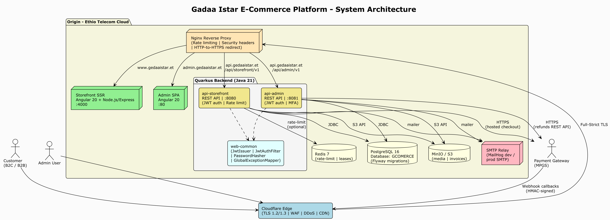
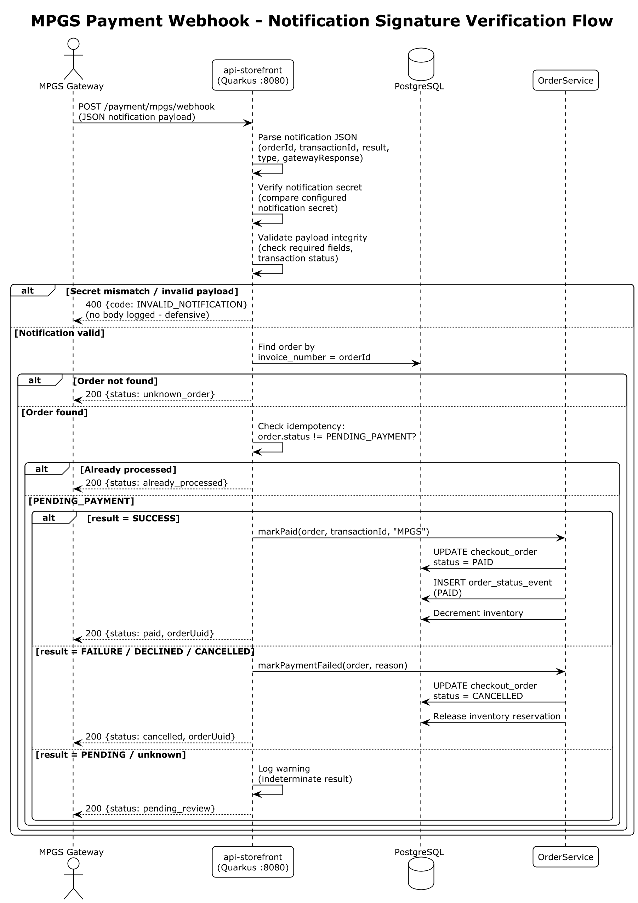

# Merchant Payment Gateway Proposal — Awash Bank MPGS Integration

**Prepared for:** Awash Bank S.C. — Merchant Acquiring / eCommerce Acquiring Department
**Prepared by:** Gadaa Istar J&M Business Group plc
**Application:** Gadaa Istar Export E-Commerce Platform (gcomerce)
**Document version:** 1.0
**Date:** October 2026

---

## 1. Cover Page

| | |
|---|---|
| **Company name** | Gadaa Istar J&M Business Group plc |
| **Legal address** | Addis Ababa, Ethiopia |
| **Contact email** | hailubiniam73@gmail.com |
| **Website (production)** | https://gedaaistar.et |
| **Admin portal** | https://admin.gedaaistar.et |
| **API base** | https://api.gedaaistar.et |
| **Application name** | Gadaa Istar Export E-Commerce Platform |
| **Requested service** | Mastercard Payment Gateway Services (MPGS) merchant acquiring — Hosted Checkout |
| **Purpose of this document** | Business and product proposal submitted to Awash Bank for MPGS merchant onboarding |

---

## 2. Executive Summary

Gadaa Istar J&M Business Group plc is an Ethiopian export company that sells Ethiopian coffee (raw and processed) and specialty agricultural products — including white products and spicy products — to international buyers. We operate a custom-built, hybrid **B2B + B2C e-commerce platform** at https://gedaaistar.et through which overseas retail customers and wholesale buyers browse our catalog, request quotes, place orders, and pay online.

We are requesting Awash Bank to onboard us as an **MPGS merchant** so that our customers can pay by card through the Awash Bank–provided Mastercard Payment Gateway Services hosted checkout. Our platform is **already engineered for MPGS**: the hosted checkout session flow, payment confirmation webhook, order-status reconciliation, and the admin refund path are implemented and tested — we only need Awash Bank merchant credentials and webhook configuration to go live.

Card data is **never entered on, transmitted through, or stored by our servers**. All card details are captured on the gateway's PCI-DSS-certified hosted payment page, which places the platform in the **PCI DSS SAQ-A** compliance scope — the simplest and lowest-risk category for both merchant and acquirer.

---

## 3. About the Company

Gadaa Istar J&M Business Group plc is an Addis Ababa–based export business specializing in:

- **Ethiopian coffee** — raw (green) and processed specialty coffee for international markets.
- **White products** — specialty agricultural white goods for export.
- **Spicy products** — Ethiopian spices and related agricultural products.

The company serves two customer segments through a single platform:

- **B2C retail buyers** — international consumers purchasing retail quantities at retail pricing.
- **B2B wholesale buyers** — importers, distributors, and roasters who register with company details, are approved by our team, receive wholesale price lists, and transact under minimum-order-quantity (MOQ) rules.

The platform was developed in-house, is fully owned and operated by Gadaa Istar, and is hosted on **Ethio Telecom Cloud** with **Cloudflare** providing TLS termination, CDN, WAF, and DDoS protection at the edge.

---

## 4. About the Product — What the Platform Does

### 4.1 Storefront (customer-facing)

The public storefront at https://gedaaistar.et is a server-side-rendered web application that provides:

- **Product catalog** — categorized catalog of coffee, white, and spicy products with rich media, variant-level pricing and inventory, and search-optimized pages (SEO meta tags, JSON-LD, sitemap).
- **Guest and registered carts** — visitors can build a cart before signing in; carts persist per customer account.
- **Customer accounts** — email + password registration, email verification, password reset, profile management, address book, and preferred currency/locale.
- **Checkout** — shipping method selection (domestic road, international standard/express, warehouse pickup), VAT/zero-rated export tax calculation per destination, and hosted-gateway payment.
- **Order tracking** — customers see live order status (pending payment → paid → fulfilling → shipped → delivered) and download invoices.
- **Multilingual storefront** — English, Amharic, and Afaan Oromo interface translations.
- **CMS-driven content** — About, Our Story, and Contact pages plus homepage banners managed by staff without code changes.

### 4.2 B2B wholesale features

- **Company onboarding** — B2B applicants register with company name, TIN, and VAT number and enter a PENDING_APPROVAL state reviewed by our customer managers.
- **Customer groups and price lists** — wholesale tiers (e.g., WHOLESALE_T1, WHOLESALE_T2, VIP) each receive dedicated price lists; approved B2B buyers see their tier's pricing automatically.
- **MOQ enforcement** — minimum order quantity multipliers per group are enforced at cart and order time.
- **Quote requests** — B2B buyers submit quote requests that staff price and convert to orders.
- **Full transaction visibility** — approved buyers see their complete order and payment history; an internal viewer role can audit all customer transactions.

### 4.3 Admin back-office

A separate admin application at https://admin.gedaaistar.et gives staff role-scoped tools for:

- Product, variant, price-list, and inventory management, with server-side image thumbnailing.
- Order management — payment status, pick/pack/ship workflow, shipment notification emails.
- Refunds — gateway-initiated refunds (MPGS REFUND transaction) or manual refunds, all recorded in an audit ledger.
- Customer management — approval, status changes, group assignment, admin-initiated password reset.
- CMS pages and banners, shipping methods, coupons, reports, and a notification center.

### 4.4 Transactional email

Verification, password-reset, B2B approval/rejection, shipment, and coupon-report emails are sent through an SMTP relay.

---

## 5. Business Model and Order Lifecycle

1. A customer (or guest) browses the catalog and adds items to a cart; inventory is reserved.
2. At checkout the customer selects a shipping method; the platform computes VAT/export tax and a grand total in the cart currency.
3. Order creation is idempotent (an Idempotency-Key prevents duplicate orders from retries). The order enters **PENDING_PAYMENT**.
4. The customer is redirected to the payment gateway's hosted checkout and pays by card.
5. The gateway notifies our webhook; on a verified successful payment the order becomes **PAID**, inventory is decremented, and an invoice is issued from a gap-free, per-fiscal-year sequence.
6. Staff fulfil the order (fulfilling → shipped → delivered); the customer is emailed at each step.
7. Unpaid orders are automatically cancelled by a scheduled sweeper after their TTL, releasing the inventory reservation.
8. Post-payment, admins can issue full or partial refunds through the gateway API; every refund is ledgered.

---

## 6. System Architecture

*Figure 1: Platform system architecture — Cloudflare edge in front of Ethio Telecom Cloud origin.*

| Layer | Technology |
|---|---|
| Storefront frontend | Angular 20, server-side rendering (Node.js/Express) |
| Admin frontend | Angular 20 SPA |
| Backend APIs | Java 21 + Quarkus 3.x — separate storefront and admin runtimes |
| Database | PostgreSQL 16, Flyway-managed schema migrations |
| Object storage | MinIO / S3 — product media and invoice files |
| Cache / rate limiting | Redis 7 (multi-instance rate limiter, distributed lease) |
| Reverse proxy | Nginx — rate limiting, security headers, HTTPS redirect |
| Edge / CDN / WAF | Cloudflare — TLS 1.2/1.3 Full-Strict, WAF, DDoS, CDN |
| Hosting | Ethio Telecom Cloud |
| CI/CD | GitHub Actions — backend tests (JUnit 5, RestAssured, Testcontainers), frontend lint/build |

The platform is stateless at the application tier (JWT authentication, no server-side sessions) so it can scale horizontally behind Nginx.

---

## 7. Payment Processing Model

### 7.1 Hosted checkout — no card data on our servers

The platform exclusively uses **hosted payment pages**. When a customer pays:

- Our backend creates a payment session/redirect payload server-side using merchant API credentials.
- The customer's browser is redirected to the gateway's hosted page.
- The customer enters card details **only on the gateway page** — PAN, expiry, and CVV never touch our infrastructure.
- The gateway returns the customer to our storefront and sends a server-to-server payment notification to our API.
- Our backend verifies the notification, updates the order, and stores only the transaction reference — never card data.

### 7.2 Existing payment integrations

| Gateway | Use | Status |
|---|---|---|
| **MPGS (Mastercard Payment Gateway Services)** | International card payments via Hosted Checkout | **Implemented and tested — awaiting acquiring-bank credentials** |
| CyberSource Secure Acceptance | International card payments (Visa/Mastercard/Amex) | Implemented — alternate/acquiring option |
| YagoutPay | Domestic ETB payments — telebirr, CBE Birr, M-Pesa, cards | Implemented — UAT pending |

The checkout presents whichever gateways are configured; customers pick their method. MPGS will be the primary card rail once Awash Bank credentials are issued.

### 7.3 PCI DSS posture

Because every payment method uses a hosted page, the platform qualifies for **PCI DSS SAQ-A** — no cardholder data is stored, processed, or transmitted by merchant systems. This is the lightest compliance scope and minimizes risk for Gadaa Istar and the acquiring bank.

---

## 8. Proposed Awash Bank MPGS Integration

### 8.1 Integration method

**MPGS Hosted Checkout** (Checkout.js lightbox / redirect), MPGS REST API version 62. This is the integration method Awash Bank offers through its MPGS merchant service and the one already implemented in our codebase.

### 8.2 Payment flow (implemented)

1. Customer selects **Mastercard (MPGS)** at checkout and confirms the order.
2. Backend calls MPGS `CREATE_CHECKOUT_SESSION` (Basic auth `merchant.<MID>:<API password>`) with the order amount, currency, our invoice number as the order reference, and return/cancel URLs on https://gedaaistar.et.
3. Storefront loads `checkout.js` from the gateway and opens the hosted checkout with the session id; the customer pays on the MPGS page. Merchant name, phone, and email configured by us appear on the page.
4. MPGS posts a **server-to-server notification** to `POST /api/storefront/v1/payment/mpgs/webhook`.
5. Backend verifies the **notification secret** (constant-time comparison), validates the payload, looks up the order by invoice number, enforces idempotency (only `PENDING_PAYMENT` orders transition), then marks the order **PAID** and decrements inventory — or **CANCELLED** with inventory released on failure.
6. As a fallback for notifications that arrive late, the storefront return page polls order status and the backend can call MPGS `RETRIEVE_ORDER` to reconcile `resultIndicator`/`successIndicator` without trusting the browser.

*Figure 2: MPGS payment notification — secret verification and order-state handling.*

### 8.3 Refunds (implemented)

Admins issue refunds from the back-office. For MPGS orders the backend calls the MPGS `REFUND` transaction API (`PUT …/order/{orderId}/transaction/{txnId}`) with the amount and currency; the gateway transaction id is stored against an `order_refund` audit row. Manual refunds are also supported and ledgered.

### 8.4 Environments

| Environment | Gateway endpoint | Purpose |
|---|---|---|
| Test | `https://test-gateway.mastercard.com` (or Awash Bank TEST URL) | Integration verification with TEST merchant credentials |
| Production | Awash Bank production gateway URL | Live acquiring once UAT is signed off |

All gateway URLs and credentials are configuration, not code — switching from test to production requires only new environment values and a feature flag.

---

## 9. What We Request from Awash Bank

To complete onboarding we kindly request:

| # | Item | Notes |
|---|---|---|
| 1 | Merchant agreement + MDR/settlement terms | Card-not-present e-commerce acquiring; settlement account at Awash Bank |
| 2 | TEST merchant credentials | Merchant ID (`TEST…`), API password, notification/webhook secret |
| 3 | Production merchant credentials | Issued after UAT sign-off |
| 4 | Webhook registration | Our endpoint: `https://api.gedaaistar.et/api/storefront/v1/payment/mpgs/webhook`; notification secret must be configured on the merchant profile |
| 5 | Confirmation of enabled features | Hosted Checkout, PURCHASE operation, REFUND capability, supported currencies (USD primary; ETB and others per agreement), 3-D Secure settings |
| 6 | UAT support | Test card numbers, expected test scenarios, and a bank contact for certification |
| 7 | Go-live approval | Confirmation to switch to production credentials |

---

## 10. Security and Compliance Summary

- **PCI DSS SAQ-A** — card data never reaches merchant systems (Section 7.3).
- **TLS everywhere** — TLS 1.2/1.3 browser-to-edge and edge-to-origin (Cloudflare Full-Strict); HTTPS for all gateway calls.
- **Webhook integrity** — notification-secret verification with constant-time comparison; malformed payloads rejected without logging bodies.
- **Idempotent payment handling** — duplicate notifications and retries cannot double-pay or double-fulfil an order.
- **Authentication** — BCrypt-hashed passwords, short-lived JWTs, rotating refresh tokens; mandatory TOTP MFA for every admin account.
- **Authorization** — role-based access control at database, API, and UI layers (SUPERADMIN, PRODUCT_MANAGER, ORDER_MANAGER, CUSTOMER_MANAGER, FINANCE).
- **Defense in depth** — Cloudflare WAF/DDoS → Nginx rate limits → application rate limiting → JWT → RBAC → input validation → parameterized queries.
- **Secrets management** — all gateway credentials via environment variables in development and HashiCorp Vault in staging/production; nothing in source control.
- **National compliance** — Ethiopian VAT (ERCA) tax classes and gap-free fiscal-year invoice sequences; web application security audit documentation prepared for INSA assessment.

---

## 11. Implementation Readiness and Next Steps

| Milestone | Owner | Status / Dependency |
|---|---|---|
| MPGS hosted checkout code (session create, webhook, retrieve-order fallback) | Gadaa Istar | Complete and unit/integration tested |
| MPGS refund flow (admin + gateway REFUND API) | Gadaa Istar | Complete |
| TEST credentials + webhook secret | Awash Bank | Required to begin certification |
| UAT against Awash Bank test gateway | Both | After credentials are issued |
| Production credentials + go-live flag | Awash Bank | After UAT sign-off |

Because the payment seams are already built and tested, enabling Awash Bank MPGS is a configuration and certification exercise rather than a development project.

---

## 12. Contact

| Name | Role | Contact |
|---|---|---|
| Gadaa Istar J&M Business Group plc | Company | Email: info@gedaaistar.et — Addis Ababa, Ethiopia |
| Technical Lead | E-commerce platform | Email: hailubiniam73@gmail.com |
| DevOps / Infrastructure | Hosting & network | Email: devops@gedaaistar.et |

We thank Awash Bank for considering this proposal and look forward to partnering on secure, card-based online payments for Ethiopian export trade.

---

**Gadaa Istar J&M Business Group plc**
Addis Ababa, Ethiopia
October 2026
