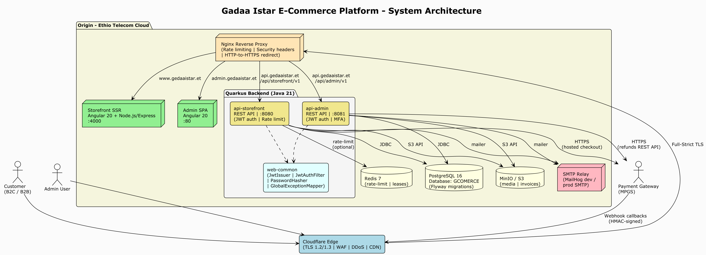
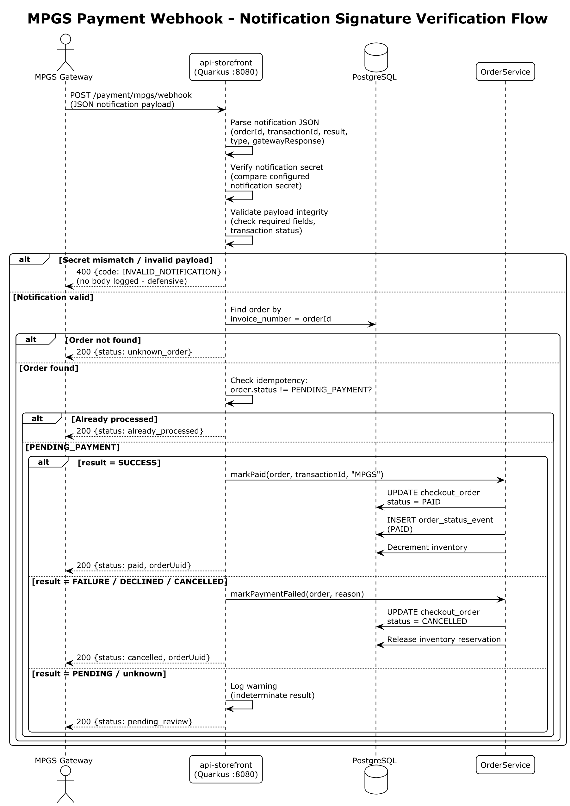

# System & Architecture Design Document (SDD)

**Document Title:** Gadaa Istar Export E-Commerce Platform — System & Architecture Design Document

**Prepared for:** Information Network Security Administration (INSA), Cyber Security Audit Division

**Prepared by:** Gadaa Istar J&M Business Group plc

**Application:** Gadaa Istar Export E-Commerce Platform (internal code name: `gcomerce`)

**Document version:** 1.0

**Date:** July 2026

---

## 1. Introduction

### 1.1 Purpose

This System & Architecture Design Document (SDD) describes the architecture, component design, data model, deployment topology, and security design of the **Gadaa Istar Export E-Commerce Platform** (`gcomerce`). It is submitted to the Information Network Security Administration (INSA) alongside the **Software Requirements Specification (SRS)** and the **Web Application Security Audit Documentation** as part of the package required for the web application security audit.

Where the SRS answers *what* the system does, this SDD answers *how* it is built and deployed. It is written so that an INSA auditor can trace any requirement in the SRS to the components, endpoints, data structures, and infrastructure that realise it, and so that the defense-in-depth security posture of the platform is explicit and verifiable.

### 1.2 Scope

This document covers the three in-scope surfaces of the platform:

1. **Public storefront** — `https://gadaaistar.et` — Angular 20 SSR application.
2. **Admin back-office** — `https://admin.gadaaistar.et` — Angular 20 SPA.
3. **REST APIs** — `https://api.gadaaistar.et` — two Quarkus runtimes (`api-storefront`, `api-admin`).

It covers the supporting infrastructure (PostgreSQL, MinIO/S3, Redis, Nginx, Cloudflare, SMTP, MPGS) as it relates to the application design. It does not redesign third-party services (MPGS hosted page, Cloudflare edge internals, Ethio Telecom Cloud hypervisor).

### 1.3 Definitions, Acronyms, and Abbreviations

The glossary in the SRS (Section 1.3) applies in full to this document. Additional terms used here:

| Term | Definition |
|---|---|
| **CDI** | Contexts and Dependency Injection (Jakarta) |
| **DDL** | Data Definition Language |
| **JDK** | Java Development Kit |
| **JOSE** | JSON Object Signing and Encryption |
| **MDC** | Mapped Diagnostic Context (SLF4J) |
| **Panache** | Quarkus-specific JPA repository layer |
| **RESTEasy Reactive** | Quarkus non-blocking JAX-RS implementation |
| **SBOM** | Software Bill of Materials |
| **Testcontainers** | JUnit integration-test container library |

### 1.4 References

- Companion: *Software Requirements Specification (SRS)*, same version and date.
- Companion: *Web Application Security Audit Documentation*, same version and date.
- OWASP Secure Coding Practices; OWASP Top 10 (2021).
- PCI DSS v4.x and SAQ-A.
- RFC 7519 (JWT), RFC 6238 (TOTP), RFC 4648 (Base32).
- Quarkus, Angular, PostgreSQL, Flyway, Nginx, Cloudflare official documentation.

### 1.5 Overview

Section 2 presents the system architecture and the defense-in-depth security architecture. Section 3 details the component design — backend modules, REST API surface, frontend apps, and shared libraries. Section 4 documents the data model (entities and Flyway migrations). Section 5 describes the deployment topology and infrastructure. Section 6 covers cross-cutting concerns: security design, observability, error handling, and configuration. Section 7 maps requirements to design elements for traceability.

---

## 2. System Architecture

### 2.1 System Architecture Diagram



*Figure 1: Gadaa Istar E-Commerce Platform — System Architecture (PlantUML source: `diagrams/01-system-architecture.puml`)*

The platform is a layered, stateless, horizontally-scalable system. Traffic flows from end users (customers, admins) and the MPGS gateway through Cloudflare's edge, then to an Nginx reverse proxy on the origin (Ethio Telecom Cloud), which routes to the appropriate tier:

- `gadaaistar.et` → Storefront SSR (Angular 20 + Node.js/Express, port 4000)
- `admin.gadaaistar.et` → Admin SPA (Angular 20, port 80)
- `api.gadaaistar.et/api/storefront/v1` → `api-storefront` Quarkus runtime (port 8080)
- `api.gadaaistar.et/api/admin/v1` → `api-admin` Quarkus runtime (port 8081)

Both Quarkus runtimes share a single PostgreSQL 16 database (`GCOMERCE`) and a single schema. They also share MinIO/S3 for object storage, Redis (optional) for distributed rate limiting and leases, and an SMTP relay for transactional email. Both runtimes depend on a shared `web-common` module that provides JWT issuance/verification, BCrypt password hashing, the security context, correlation ID filter, and the global exception mapper.

### 2.2 Security Architecture — Defense in Depth


*Figure 2: Security Architecture — Defense in Depth across 4 Layers (PlantUML source: `diagrams/05-security-architecture.puml`)*

Security is organised in four layers so that multiple layers must fail for an attack to succeed:

- **Layer 1 — Cloudflare Edge:** WAF (managed + custom rules), DDoS protection, TLS 1.2/1.3 (Full-Strict), edge rate limiting.
- **Layer 2 — Nginx Reverse Proxy:** Rate limiting (`gi_api_zone` 20 r/s, `gi_auth_zone` 5 r/s), security headers (HSTS, X-Frame-Options, X-Content-Type-Options, Referrer-Policy, Permissions-Policy), HTTP→HTTPS redirect.
- **Layer 3 — Quarkus Application:** `CorrelationIdFilter`, `RateLimitFilter` (sliding window, per-endpoint buckets), `JwtAuthFilter` (Bearer token verify: signature, issuer, audience, expiry), `SecurityContextHolder` (requireCustomer / requireAdmin / requireAnyRole), Bean Validation (`@Valid`, JSR 380), `GlobalExceptionMapper` (structured errors, no stack-trace leakage).
- **Layer 4 — Data Security:** JPA/Hibernate (parameterised queries, no SQL injection), BCrypt cost 12 (password hashing), JWT HS256 via Nimbus JOSE, rotating refresh tokens (SHA-256 hashed at rest), TOTP MFA (RFC 6238, mandatory for admins), HMAC-SHA256 (payment gateway signatures).

### 2.3 Key Data Flow Diagrams

#### 2.3.1 Customer Purchase Flow (B2C)


*Figure 3: Customer Purchase Flow (B2C) — Data Flow Diagram (PlantUML source: `diagrams/02-customer-purchase-flow.puml`)*

The B2C purchase flow: customer browses catalog → adds to cart (guest or authenticated) → signs in / checks out → selects address, shipping, coupon → places order (cart frozen into `PENDING_PAYMENT` order, inventory reserved) → backend creates MPGS hosted-checkout session → customer enters card on MPGS hosted page → MPGS posts HMAC-signed webhook → backend verifies signature, marks order `PAID`, releases reserved inventory → customer sees confirmation.

#### 2.3.2 B2B Quote Flow


*Figure 4: B2B Quote Request Flow — Data Flow Diagram (PlantUML source: `diagrams/03-b2b-quote-flow.puml`)*

The B2B quote flow: B2B customer builds cart → submits quote request (`SUBMITTED`) → admin reviews (`UNDER_REVIEW`), edits proposed unit prices per line → admin sends quote (`SENT`) with validity period → customer accepts (`ACCEPTED`) → admin converts to `PENDING_PAYMENT` order (`CONVERTED`) → standard payment flow follows.

#### 2.3.3 Admin Login Flow with Mandatory MFA


*Figure 5: Admin Login Flow — Two-Step Authentication with Mandatory TOTP MFA (Sequence Diagram) (PlantUML source: `diagrams/04-admin-login-mfa-sequence.puml`)*

Admin login is a two-step flow: step 1 verifies email + password and returns a short-lived MFA challenge token (purpose-scoped JWT, TTL 300s); step 2 verifies the TOTP code (RFC 6238, 30s step, 6 digits, window tolerance ±1, constant-time comparison) and issues access + refresh tokens. First-time login requires MFA enrollment via a QR code rendered from the `otpauth://` provisioning URI.

#### 2.3.4 Payment Webhook Flow



*Figure 6: MPGS Payment Webhook — Notification Signature Verification Flow (PlantUML source: `diagrams/06-payment-webhook-flow.puml`)*

---

## 3. Component Design

### 3.1 Backend Module Structure

The backend is a multi-module Gradle 8.x project. Active modules (from `settings.gradle`):

| Module | Type | Responsibility |
|---|---|---|
| `common` | Pure Java library | Shared DTOs, enums, exceptions, utilities. No Quarkus runtime. Dependencies: jakarta.validation-api, jackson-annotations, slf4j-api. |
| `persistence` | Library | JPA entities, Panache repositories, Flyway migrations. Dependencies: quarkus-hibernate-orm-panache, quarkus-hibernate-validator, postgresql driver, quarkus-flyway. |
| `web-common` | Library | Shared JAX-RS/CDI infrastructure: `JwtIssuer`, `PasswordHasher`, `SecurityContextHolder`, `JwtAuthFilter`, `CorrelationIdFilter`, `GlobalExceptionMapper`. Dependencies: quarkus BOM, common, JAX-RS/CDI APIs, nimbus-jose-jwt. |
| `api-storefront` | Quarkus runtime (port 8080) | Public/customer REST API. Owns Flyway migrations. Dependencies: RESTEasy, Jackson, OpenAPI, Health, Micrometer/Prometheus, Mailer, Scheduler, Cache, Redis client, BCrypt, commons-codec. |
| `api-admin` | Quarkus runtime (port 8081) | Admin REST API. Flyway disabled (shared schema). Dependencies: as storefront + MinIO SDK, Thumbnailator. |

### 3.2 REST API Surface

#### 3.2.1 Storefront API (`/api/storefront/v1`)

| Resource class | Base path | Endpoints (method → purpose) |
|---|---|---|
| `AuthResource` | `/auth` | POST `/register`, POST `/login`, POST `/refresh`, POST `/logout`, GET `/me`, PATCH `/me`, POST `/me/change-password`, POST `/resend-verification`, POST `/verify-email`, POST `/forgot-password`, POST `/reset-password` |
| `CartResource` | `/cart` | GET `/`, POST `/items`, PATCH `/items/{productId}`, DELETE `/items/{productId}`, DELETE `/`, POST `/merge` |
| `GuestCartResource` | `/guest-cart` | GET `/`, POST `/items`, PATCH `/items/{productId}`, DELETE `/items/{productId}`, DELETE `/` (uses `X-Guest-Session-Key` header) |
| `StorefrontCatalogResource` | `/catalog` | GET `/products`, GET `/products/search`, GET `/products/{slug}` |
| `OrderResource` | `/me/orders` | GET `/`, GET `/transactions`, GET `/{uuid}`, POST `/`, GET `/{uuid}/payment-payload`, POST `/{uuid}/payment-method`, POST `/{uuid}/confirm-mpgs` |
| `OrderTrackingResource` | `/me/orders/{uuid}/tracking` | GET `/` (public, no auth) |
| `QuoteResource` | `/me/quotes` | POST `/`, GET `/`, GET `/{uuid}`, POST `/{uuid}/accept` |
| `AddressResource` | `/me/addresses` | GET `/`, GET `/{id}`, POST `/`, PATCH `/{id}`, DELETE `/{id}` |
| `PaymentMethodsResource` | `/me/payment-methods` | GET `/` |
| `MpgsWebhookResource` | `/payment/mpgs/webhook` | POST `/` (notification-secret verified) |
| `CyberSourceWebhookResource` | `/payment/cybersource/webhook` | POST `/` (HMAC-verified; secondary gateway) |
| `ShippingResource` | `/me/shipping` | GET `/quotes` |
| `TaxResource` | `/tax` | GET `/rules/{countryCode}` |
| `StorefrontCmsResource` | `/cms` | GET `/pages`, GET `/pages/{slug}`, GET `/banners` |
| `CouponPreviewResource` | `/me/coupon-preview` | GET `/` |
| `SeoResource` | `/seo` | GET `/robots.txt`, GET `/sitemap.xml` |
| `SystemResource` | `/system` | GET `/hello` |

#### 3.2.2 Admin API (`/api/admin/v1`)

| Resource class | Base path | Endpoints (method → purpose) |
|---|---|---|
| `AdminAuthResource` | `/auth` | POST `/login` (step 1 → MFA challenge), POST `/verify-mfa` (step 2 → tokens), POST `/refresh`, POST `/logout`, GET `/me` |
| `AdminUsersResource` | `/admin-users` | GET `/`, POST `/{id}/mfa/reset` (SUPERADMIN) |
| `ProductsResource` | `/products` | GET `/`, GET `/{id}`, POST `/`, PATCH `/{id}`, DELETE `/{id}` (archive), POST `/{id}/media`, DELETE `/{id}/media/{mediaId}`, GET `/export.csv`, POST `/import-csv` |
| `VariantsResource` | `/products/{productId}/variants` | GET `/`, POST `/`, PATCH `/{variantId}`, DELETE `/{variantId}`, GET `/inventory`, POST `/{variantId}/inventory/adjust`, PUT `/{variantId}/inventory` |
| `InventoryResource` | `/inventory` | GET `/`, GET `/products/{productId}`, POST `/products/{productId}/adjust`, PUT `/products/{productId}` |
| `PriceListsResource` | `/price-lists` | GET `/`, GET `/{id}`, POST `/`, PATCH `/{id}`, DELETE `/{id}`, PUT `/{id}/entries`, DELETE `/{id}/entries/{entryId}` |
| `CustomerGroupsResource` | `/customer-groups` | GET `/`, POST `/`, PATCH `/{id}`, DELETE `/{id}` |
| `AdminOrderResource` | `/orders` | GET `/`, GET `/{uuid}`, POST `/{uuid}/transition` |
| `CustomersResource` | `/customers` | GET `/`, GET `/{id}`, POST `/{id}/status`, POST `/{id}/approve-b2b`, POST `/{id}/verify-email`, POST `/{id}/revoke-sessions`, POST `/{id}/reset-password`, POST `/{id}/group` |
| `AdminQuoteResource` | `/quotes` | GET `/`, GET `/{uuid}`, POST `/{uuid}/review`, PATCH `/{uuid}/items/{lineId}`, POST `/{uuid}/send`, POST `/{uuid}/reject`, POST `/{uuid}/convert` |
| `CouponsResource` | `/coupons` | GET `/`, GET `/{id}`, POST `/`, PATCH `/{id}`, DELETE `/{id}`, POST `/reports/expiry-check`, POST `/reports/usage-report` |
| `CmsResource` | `/cms` | GET `/pages`, GET `/pages/{id}`, POST `/pages`, PATCH `/pages/{id}`, DELETE `/pages/{id}`, GET `/banners`, GET `/banners/{id}`, POST `/banners`, PATCH `/banners/{id}`, DELETE `/banners/{id}` |
| `ShippingMethodsResource` | `/shipping-methods` | GET `/`, GET `/{id}`, POST `/`, PATCH `/{id}`, DELETE `/{id}`, GET `/{id}/zones`, POST `/{id}/zones`, PATCH `/zones/{zoneId}`, DELETE `/zones/{zoneId}` |
| `RefundResource` | `/orders/{uuid}/refunds` | GET `/`, POST `/` (ORDER_MANAGER / SUPERADMIN) |
| `UploadsResource` | `/uploads` | POST `/product-media` (S3 upload) |
| `StatsResource` | `/stats` | GET `/` (dashboard KPIs) |
| `NotificationsResource` | `/notifications` | GET `/` (admin bell counts) |
| `SystemResource` | `/system` | GET `/hello` |

### 3.3 Backend Services

#### 3.3.1 Storefront Services

| Service | Responsibility |
|---|---|
| `AuthService` | Customer registration, login, profile management |
| `EmailVerificationService` | Email verification token lifecycle (issue, consume, TTL 60 min) |
| `PasswordResetService` | Password reset token lifecycle (issue, consume, TTL 30 min) |
| `CartService` | Cart CRUD, guest cart handling, merge-on-sign-in |
| `StorefrontCatalogService` | Product listing, search, price resolution by customer group |
| `OrderService` | Order placement (freeze cart, reserve inventory), status transitions, idempotency |
| `QuoteService` | B2B quote creation, acceptance |
| `AddressService` | Customer address CRUD |
| `ShippingQuoteService` | Live shipping quotes by cart weight and destination |
| `TaxService` | Tax rule resolution by country + tax class |
| `StorefrontCmsService` | Published CMS pages and active banners |
| `CouponService` | Coupon validation and discount computation |
| `MpgsService` | MPGS session creation, order retrieval, webhook verification |
| `CyberSourceService` | CyberSource signed payload generation and verification (secondary gateway) |
| `RefreshTokenService` | Rotating refresh token issuance and revocation for customers |
| `MailService` | Transactional email sending wrapper |

#### 3.3.2 Admin Services

| Service | Responsibility |
|---|---|
| `AdminAuthService` | Admin login with MFA challenge, token issuance |
| `ProductsService` | Product CRUD, media management, CSV import/export |
| `VariantsService` | Product variant CRUD |
| `InventoryService` | Inventory adjust/overwrite |
| `PriceListsService` | Price list and tiered entry management |
| `CustomerGroupsService` | Customer group CRUD |
| `AdminOrderService` | Order listing, status transitions |
| `CustomersService` | Customer management, B2B approvals, session revocation |
| `AdminQuoteService` | Quote review, pricing, conversion to order |
| `CouponsService` | Coupon CRUD |
| `CmsService` | CMS pages and banners |
| `ShippingMethodsService` | Shipping methods and per-country rate zones |
| `RefundService` | Refund processing (MPGS / CyberSource / MANUAL) |
| `AdminUsersService` | Admin user listing, MFA reset |
| `CouponReportScheduler` | Daily expiry check, weekly usage report |
| `S3Service` | S3/MinIO storage operations |
| `ImageProcessingService` | Thumbnail generation (300px card, 800px detail) |

### 3.4 Scheduled Jobs

| Job | Schedule | Purpose |
|---|---|---|
| `AbandonedOrderSweeper` | Every 5 minutes (configurable), delayed 30s after boot | Auto-cancel `PENDING_PAYMENT` orders older than TTL (default 60 min); releases inventory reservations; uses a distributed lease to prevent concurrent runs across replicas; re-checks status before cancel; `ConcurrentExecution.SKIP` |
| `CouponReportScheduler` (expiry) | Daily at 08:00 UTC | Find coupons expiring within warning window (default 7 days); email finance team |
| `CouponReportScheduler` (usage) | Weekly Monday at 09:00 UTC | Send coupon usage report for last N days (default 7) |
| `InMemoryRateLimitBackend` reaper | Every 5 minutes | Reap stale rate-limit queues (no hits in 15 min) to bound memory (memory backend only) |

### 3.5 Frontend Applications

#### 3.5.1 Storefront (Angular 20 SSR)

- **Workspace:** `frontend/apps/storefront`, Angular 20.3.26, TypeScript 5.9.0.
- **Rendering:** Server-side rendered via `@angular/ssr` + Express (`server.ts`, port 4000). Static assets served with 1-year cache. All routes rendered via `CommonEngine`.
- **State management:** Angular signals (no NgRx). `AuthService` exposes `currentCustomer`, `isAuthenticated`, `accessToken` as computed signals; persisted to `localStorage` (`gadaa.storefront.session`).
- **HTTP interceptor chain** (`app.config.ts`): `correlationInterceptor` (X-Correlation-Id) → `authInterceptor` (Bearer token + silent refresh on 401) → `timeoutInterceptor` → `errorInterceptor` (normalises error envelope).
- **Cart service:** Dual mode — authenticated (`/cart`) vs guest (`/guest-cart` with `X-Guest-Session-Key`); auto-merge on sign-in via `effect()` watching auth state; guest session key in `localStorage` (`gi-guest-session-key`).
- **Routes & guards:** `authGuard` (blocks anonymous from `/account`, `/checkout`), `guestGuard` (prevents signed-in from `/login`, `/register`). Routes include home, shop (with `:category`), product detail (`:slug`), cart, checkout (+ `/return`, `/cancel`), account portal (profile, addresses, orders, transactions, quotes), auth flows, order tracking, wishlist, CMS pages.
- **Forms:** Reactive forms with `Validators` mirroring backend Bean Validation (email, min password 8, max lengths, B2B company fields required when type is B2B, password match custom validator).

#### 3.5.2 Admin (Angular 20 SPA)

- **Workspace:** `frontend/apps/admin`, Angular 20.3.26.
- **Rendering:** Single-page application, no SSR (internal tool).
- **State management:** Signals. `AdminAuthService` exposes `currentAdmin`, `isAuthenticated` (checks refresh-token wall-clock expiry against a 30s tick signal), `accessToken`, `pendingChallenge`; persisted to `sessionStorage` (`gadaa.admin.session`); pending MFA challenge in `gadaa.admin.pending-mfa`.
- **Guards:** `authGuard`, `guestGuard`, `mfaChallengeGuard` (only allows `/verify-mfa` when a pending challenge exists), `roleGuard` (reads `route.data.roles`; defined for future per-route enforcement; current RBAC enforced server-side and via sidebar `canSee` filtering).
- **Idle timeout:** `IdleTimeoutService` — 10 minutes of inactivity (mousemove, mousedown, keydown, touchstart, scroll, wheel), 15s check interval, immediate check on visibility change; calls `forceLogout('idle')`. Cannot be defeated by background API polling.
- **Forced logout reasons:** `expired` (refresh-token wall-clock elapsed), `idle` (10-min inactivity), `refresh-failed`.
- **MFA enrollment UI:** `VerifyMfaComponent` — dual mode (enrollment vs verification); QR code via `angularx-qrcode` rendered from `otpauthUri` (secret never leaves browser); manual `secretBase32` entry; 6-digit input validated `/^\d{6}$/`.
- **Routes:** login, verify-mfa, dashboard, admin-users, products (list + tabbed editor: details, media, inventory, pricing, variants), price-lists, shipping-methods, orders, quotes, customers, customer-groups, coupons, CMS pages, CMS banners.

#### 3.5.3 Shared UI Kit (`frontend/libs/ui-kit`)

- Brand tokens (TypeScript `BRAND_COLORS` + SCSS CSS custom properties): navy, red (CTA), gold (accent), cream background, espresso.
- Typography: Playfair Display (display), Inter (body), Noto Sans Ethiopic.
- Material Design 3 theme with custom brand palettes.
- Semantic aliases: `--gi-brand`, `--gi-cta`, `--gi-accent`.

### 3.6 Payment Integration Design

#### 3.6.1 MPGS (Mastercard Payment Gateway Services) — Primary

**Service:** `MpgsService.java` (storefront), `MpgsRefundClient.java` (admin).

**Hosted-checkout flow:**

1. `OrderService.createFromCart` creates a `PENDING_PAYMENT` order (cart frozen, inventory reserved).
2. Frontend calls `GET /me/orders/{uuid}/payment-payload`.
3. `MpgsService.createCheckoutSession` calls the MPGS REST API:
   - Endpoint: `{gateway-url}/api/rest/version/{api-version}/merchant/{merchant-id}/session`
   - Operation: `CREATE_CHECKOUT_SESSION` with order amount, currency, return/cancel URLs.
   - Returns: `sessionId`, `successIndicator`.
4. Order is updated with `mpgsSessionId` and `mpgsSuccessIndicator`.
5. Frontend loads the MPGS Checkout.js library and configures it with the session fields.
6. The customer enters card data on the MPGS-hosted page. **The platform never receives PAN or CVV.**
7. MPGS posts a JSON webhook to `MpgsWebhookResource`.
8. `MpgsService.verifyNotificationSecret` validates the `notificationSecret` field using constant-time comparison.
9. On CAPTURE/AUTHORIZE with SUCCESS → `OrderService.markPaid`; on FAILED/CANCELLED → `OrderService.markPaymentFailed`.
10. Idempotency: a webhook for an order already moved out of `PENDING_PAYMENT` is ignored.

**Webhook verification:** The `notificationSecret` field is compared to the configured value in constant time. The `order.id` is mapped to the invoice number to locate the order.

**Refunds:** `MpgsRefundClient` uses the MPGS REST API (gateway-url, merchant-id, api-password, api-version). Falls back to `MANUAL` mode when credentials are not configured.

**Configuration keys:** `gadaa.mpgs.enabled`, `gadaa.mpgs.gateway-url`, `gadaa.mpgs.merchant-id`, `gadaa.mpgs.api-password`, `gadaa.mpgs.api-version`, `gadaa.mpgs.checkout-version`, `gadaa.mpgs.notification-secret`, `gadaa.mpgs.merchant-name/phone/email`.

#### 3.6.2 CyberSource (Secondary Gateway)

A CyberSource Secure Acceptance Hosted Checkout integration is also present (`CyberSourceService`, `CyberSourceWebhookResource`, `CyberSourceRefundClient`). The flow is analogous: signed form fields posted to the CyberSource endpoint, HMAC-SHA256 signature verification on the return/notify webhook. It is retained as a secondary gateway option. The MPGS integration is the primary path referenced for this audit.

---

## 4. Data Model

### 4.1 Persistence Approach

- **Database:** PostgreSQL 16, single database `GCOMERCE`, single shared schema.
- **ORM:** Hibernate ORM + Panache (via Quarkus). All access via Panache repository methods — parameterised queries only; no string-concatenated SQL.
- **Migrations:** Flyway, 20 versioned migrations (`V1`–`V20`). `api-storefront` owns migration execution; `api-admin` has Flyway disabled. CI validates migrations apply cleanly on an empty PostgreSQL 16 database.
- **Schema validation:** Quarkus validates the schema on startup (`quarkus.hibernate-orm.database.generation=validate`).

### 4.2 Core Entities

| Entity | Key fields | Relationships |
|---|---|---|
| `Customer` | id, email (unique), passwordHash, customerType (B2C/B2B), status (PENDING_VERIFICATION/ACTIVE/SUSPENDED), firstName, lastName, companyName, companyTin, companyVatNumber, businessLicenseUrl, phone, preferredCurrency, preferredLocale, emailVerifiedAt, lastLoginAt | ManyToOne → CustomerGroup; OneToMany → CustomerAddress |
| `CustomerGroup` | code, name, priceTier, moqMultiplier | OneToMany → Customer |
| `CustomerAddress` | addressType, isDefault, streetLine1/2, city, countryCode, region, postalCode, phone | ManyToOne → Customer |
| `Product` | sku (unique), slug (unique), name, shortDescription, description, category, status (DRAFT/ACTIVE/ARCHIVED), weightKg, hsCode, originCountry, taxClassId, baseCurrency, basePrice, costPrice, minOrderQuantity, packagingNotes | OneToMany → ProductMedia, ProductVariant |
| `ProductVariant` | sku, name, priceOverride, weightKgOverride, active, version | ManyToOne → Product; OneToMany → ProductVariantAttribute |
| `ProductMedia` | url, altText, mediaType, isPrimary, sortOrder, cardThumbnailUrl, detailThumbnailUrl | ManyToOne → Product |
| `PriceList` | customerGroupId, name, currency, effectiveFrom/to | OneToMany → PriceListEntry |
| `PriceListEntry` | priceListId, productId, price, minQuantity | ManyToOne → PriceList |
| `Inventory` | productId, variantId, quantity, reservedQuantity, restockThreshold | — |
| `Cart` | customerId (unique, nullable), sessionKey (unique), currency | OneToOne → Customer; OneToMany → CartItem |
| `CartItem` | cartId, productId, variantId, quantity, unitPriceSnap, currency | ManyToOne → Cart |
| `CheckoutOrder` | uuid (unique), invoiceNumber (unique), customerId, status (PENDING_PAYMENT/PAID/FULFILLING/SHIPPED/DELIVERED/CANCELLED), currency, subtotal, taxTotal, shippingTotal, discountTotal, refundedTotal, grandTotal, shipToAddressId, billToAddressId, shippingMethodId, shippingMethodCode/Name, paymentReference, paymentProvider, paymentMethod, mpgsSessionId, mpgsSuccessIndicator, placedAt, paidAt, cancelledAt, couponCode/Description/Discount | ManyToOne → Customer, CustomerAddress, ShippingMethod; OneToMany → OrderItem, OrderStatusEvent, OrderRefund |
| `OrderItem` | orderId, productId, variantId, sku, name, variantSku, variantName, unitPrice, quantity, taxRate, taxAmount, lineTotal, primaryImageUrl | ManyToOne → CheckoutOrder |
| `OrderStatusEvent` | orderId, fromStatus, toStatus, source, actorId, note, occurredAt | ManyToOne → CheckoutOrder |
| `OrderRefund` | uuid, orderId, amount, reason, status, gatewayProvider, gatewayReference, gatewayErrorCode, initiatedByAdminId | ManyToOne → CheckoutOrder |
| `Quote` | uuid (unique), customerId, status (DRAFT/SUBMITTED/UNDER_REVIEW/SENT/ACCEPTED/REJECTED/CONVERTED), currency, subtotal, taxTotal, shippingTotal, grandTotal, customerNotes, adminNotes, validUntil, convertedOrderId | ManyToOne → Customer, CheckoutOrder; OneToMany → QuoteItem |
| `QuoteItem` | quoteId, productId, variantId, sku, name, variantSku, variantName, quantity, proposedUnitPrice, lineTotal | ManyToOne → Quote |
| `Coupon` | code (unique), description, discountType (PERCENT/FIXED_AMOUNT), discountValue, currency, minSubtotal, freeShipping, maxRedemptions, maxPerCustomer, redeemedCount, active, startsAt, expiresAt | OneToMany → CouponRedemption |
| `CouponRedemption` | couponId, orderId, customerId, code, discountAmount, redeemedAt | ManyToOne → Coupon |
| `ShippingMethod` | code, name, currency, baseCost, perKgRate, minDays, maxDays, active | OneToMany → ShippingRateZone |
| `ShippingRateZone` | shippingMethodId, countryCode, baseCost, perKgRate, minDays, maxDays, active | ManyToOne → ShippingMethod |
| `AdminUser` | email (unique), passwordHash, fullName, roleId, status (ACTIVE/SUSPENDED/DEACTIVATED), mfaSecret, mfaEnrolledAt, lastLoginAt | ManyToOne → AdminRole |
| `AdminRole` | name, description | OneToMany → AdminUser |
| `CustomerRefreshToken` | id (UUID), tokenHash, expiresAt, revokedAt, ip, replacedById | ManyToOne → Customer |
| `AdminRefreshToken` | id (UUID), tokenHash, expiresAt, revokedAt, sessionStartedAt, ip | ManyToOne → AdminUser |
| `EmailVerificationToken` | tokenHash, expiresAt, usedAt | ManyToOne → Customer |
| `PasswordResetToken` | tokenHash, expiresAt, usedAt, ip | ManyToOne → Customer |
| `TaxClass` | code (STANDARD/EXPORT/EXEMPT), description | — |
| `TaxRule` | taxClassId, countryCode, ratePercent, zeroRated, effectiveFrom/to | ManyToOne → TaxClass |
| `InvoiceSequence` | docType, fiscalYear, prefix, currentValue | — |
| `CmsPage` | slug, title, bodyHtml, seoTitle, seoDescription, status, sortOrder | — |
| `CmsBanner` | placement, title, imageUrl, altText, linkUrl, activeFrom/to, sortOrder, active | — |
| `Setting` | key, valueJson (JSONB) | — |

### 4.3 Flyway Migration History

| Migration | Summary |
|---|---|
| V1__initial_schema | `setting`, `role`, `permission`, `role_permission`, `admin_user`, `company_tax_profile`, `tax_class`, `tax_rule`, `invoice_sequence`; seeds 5 admin roles, 3 tax classes, ET 15% / export 0% rules, invoice/credit-note sequences; creates `update_updated_at()` trigger |
| V2__customer_and_auth | `customer_group`, `customer`, `customer_address`, `customer_refresh_token`, `email_verification_token`, `password_reset_token`; seeds 4 customer groups (RETAIL, WHOLESALE_T1, WHOLESALE_T2, VIP) |
| V3__admin_auth_and_mfa | `admin_role`, `admin_refresh_token`; adds `mfa_enrolled_at`; seeds bootstrap super-admin |
| V4__product_catalog | `product`, `product_media`, `price_list`, `price_list_entry`, `inventory`; seeds sample products |
| V5__cart_and_orders | `cart`, `cart_item`, `checkout_order`, `order_item`, `order_status_event` |
| V6__shipping_methods | `shipping_method`; adds shipping snapshot columns to `checkout_order`; seeds DOMESTIC_ROAD, INTL_STANDARD, INTL_EXPRESS, PICKUP_FREE |
| V7__order_refunds | `order_refund`; adds `refunded_total` to `checkout_order` |
| V8__product_variants | `product_variant`, `product_variant_attribute`; adds `variant_id` to `inventory`, `cart_item`, `order_item` |
| V9__coupons | `coupon`, `coupon_redemption`; adds coupon snapshot columns to `checkout_order` |
| V10__guest_cart | Makes `cart.customer_id` nullable; adds `session_key` (unique) for guest carts |
| V11__b2b_quotes | `quote`, `quote_item` |
| V12__media_thumbnails | Adds `card_thumbnail_url`, `detail_thumbnail_url` to `product_media` |
| V13__shipping_rate_zones | `shipping_rate_zone` |
| V14__cms_pages_banners | `cms_page`, `cms_banner` |
| V15__mpgs_payment | Adds `mpgs_session_id`, `mpgs_success_indicator`, `payment_method` to `checkout_order` |
| V16__char_to_varchar | Converts CHAR columns to VARCHAR (UUID, currency, country codes, token hashes) for Hibernate compatibility; adds `version` to `product_variant` |
| V17__merge_categories | Consolidates product categories; refreshes seed products/media/pricing/inventory |
| V18__order_item_image_url | Adds `primary_image_url` to `order_item` for rendering without a Hibernate session |
| V19__seed_admin_b2b_customer | Seeds B2B admin-viewer customer |
| V20__admin_session_hardening | Adds `session_started_at` (NOT NULL) to `admin_refresh_token`; revokes all existing admin refresh tokens (forces re-auth) |

**No card data (PAN, CVV) is stored in any table.** Payment columns on `checkout_order` hold only gateway transaction IDs and session identifiers.

---

## 5. Deployment and Infrastructure

### 5.1 Deployment Topology


*Figure 1 (repeated): System Architecture — production topology*

**Edge layer:** Cloudflare global PoPs — TLS termination (Full-Strict), WAF, DDoS protection, CDN, edge rate limiting.

**Origin (Ethio Telecom Cloud), internal subnet `10.0.1.0/24`:**

| Tier | Nodes | Port | Notes |
|---|---|---|---|
| Nginx reverse proxy | single VM | 443/80 | Cloudflare origin cert at `/etc/ssl/cloudflare/`; HTTP→HTTPS redirect on :80 |
| api-storefront | 10.0.1.10, 10.0.1.11 | 8080 | Round-robin upstream `gi_api`; `max_fails=3, fail_timeout=15s`; keepalive 32 |
| api-admin | 10.0.1.10, 10.0.1.11 | 8081 | Same upstream as storefront (routed by path) |
| Storefront SSR | 10.0.1.20, 10.0.1.21 | 4000 | Round-robin upstream `gi_storefront`; keepalive 16 |
| Admin SPA | 10.0.1.30 | 80 | Single node; keepalive 8 |
| PostgreSQL | internal | 5432 | DB `GCOMERCE` |
| MinIO / S3 | internal | 9000 (API), 9001 (console) | Buckets: `gadaa-media`, `gadaa-invoices` |
| Redis (optional) | internal | 6379 | Multi-instance rate limiting + distributed lease |

**Minimum production hardware (per node):** App tier (Quarkus) 2 vCPU / 4 GB RAM / 20 GB disk; SSR tier (Node.js) 2 vCPU / 2 GB RAM / 10 GB disk; DB tier (PostgreSQL) 4 vCPU / 8 GB RAM / 100 GB SSD; Redis (if used) 1 vCPU / 1 GB RAM.

### 5.2 Nginx Reverse Proxy

**File:** `infra/nginx/gadaa-istar.conf.example`.

- **Upstreams:** `gi_api` (10.0.1.10:8080, 10.0.1.11:8080), `gi_storefront` (10.0.1.20:4000, 10.0.1.21:4000), `gi_admin` (10.0.1.30:80).
- **Rate-limit zones:** `gi_api_zone` (20 r/s), `gi_auth_zone` (5 r/s, applied to `~ ^/api/(storefront|admin)/v1/auth/` with `burst=10 nodelay`).
- **Server blocks:**
  - `www.gadaaistar.com` / `gadaaistar.com` (443 ssl http2) → `gi_storefront`; full security headers.
  - `api.gadaaistar.com` (443 ssl http2) → `gi_api`; webhook path `/api/storefront/v1/payments/cybersource/notify` excluded from rate limiting; auth paths use `gi_auth_zone`; default uses `gi_api_zone` (`burst=40 nodelay`).
  - `admin.gadaaistar.com` (443 ssl http2) → `gi_admin`; optional IP allowlist (commented); `X-Robots-Tag: noindex,nofollow`; `Referrer-Policy: no-referrer`.
  - `:80 default_server` → 301 redirect to HTTPS.
- **TLS:** Cloudflare origin cert at `/etc/ssl/cloudflare/origin.pem`; protocols TLSv1.2, TLSv1.3.

### 5.3 Docker Compose (Local Dev / Staging)

**File:** `infra/docker-compose.yml`.

| Service | Image | Ports | Profile |
|---|---|---|---|
| postgres | postgres:16 | 5432 | default |
| minio | minio/minio:latest | 9000, 9001 | default |
| mailhog | mailhog/mailhog:latest | 1025, 8025 | default |
| redis | redis:7-alpine | 6379 | redis, app |
| api-storefront | built from ../backend (MODULE: api-storefront) | 8080 | app |
| api-admin | built from ../backend (MODULE: api-admin) | 8081 | app |
| storefront | built from ../frontend/apps/storefront | 4200:80 | app |
| admin | built from ../frontend/apps/admin | 4300:80 | app |

Volumes: `postgres-data`, `minio-data`. Health checks on postgres (`pg_isready`) and redis (`redis-cli ping`). `api-storefront` owns Flyway migrations; `api-admin` has Flyway disabled.

### 5.4 CI/CD (GitHub Actions)

**Backend CI** (`.github/workflows/backend-ci.yml`): triggers on push/PR to main/develop for `backend/**`; JDK 21 (Temurin); PostgreSQL 16 service container; jobs: (1) build & test (`./gradlew build`, uploads test reports, 7-day retention); (2) Flyway migrate + validate (`:persistence:flywayMigrate`, `flywayValidate`). Concurrency cancels in-progress runs per ref.

**Frontend CI** (`.github/workflows/frontend-ci.yml`): triggers on push/PR for `frontend/**`; Node 20; `npm ci`; `format:check`; `lint` (ESLint, zero errors); `build:storefront`; `build:admin`; uploads storefront and admin bundles (3-day retention). Concurrency cancels in-progress runs per ref.

### 5.5 Configuration Management

All configuration is externalised via environment variables with dev defaults. **No secrets in source code or committed config.** Dev loads from environment; staging/production loads secrets from HashiCorp Vault. Key configuration groups (from `.env.example` and `application.properties`):

- **PostgreSQL:** `QUARKUS_DATASOURCE_URL`, `USERNAME`, `PASSWORD`, `POSTGRES_DB=GCOMERCE`.
- **JWT:** `GADAA_JWT_STOREFRONT_SECRET`, `GADAA_JWT_ADMIN_SECRET` (32+ chars, validated on startup), `GADAA_JWT_ACCESS_TTL_MINUTES=15`, `GADAA_JWT_REFRESH_TTL_DAYS=30`, per-audience issuers.
- **Auth TTLs:** `GADAA_EMAIL_VERIFICATION_TTL_MINUTES=60`, `GADAA_PASSWORD_RESET_TTL_MINUTES=30`.
- **Admin MFA:** `GADAA_ADMIN_MFA_ISSUER`, `GADAA_ADMIN_MFA_CHALLENGE_TTL_SECONDS=300`, `GADAA_ADMIN_MFA_WINDOW_TOLERANCE=1`.
- **Admin session:** max lifetime 480 min, idle timeout 10 min.
- **Rate limiting:** `GADAA_RATELIMIT_ENABLED=true`, `GADAA_RATELIMIT_BACKEND=memory|redis`, `GADAA_RATELIMIT_MAX_QUEUE_SIZE=1024`.
- **MPGS:** `MPGS_ENABLED`, `MPGS_GATEWAY_URL`, `MPGS_MERCHANT_ID`, `MPGS_API_PASSWORD`, `MPGS_API_VERSION=62`, `MPGS_CHECKOUT_VERSION=62`, `MPGS_NOTIFICATION_SECRET`.
- **S3/MinIO:** `S3_ENDPOINT`, `S3_PUBLIC_BASE_URL`, `S3_ACCESS_KEY`, `S3_SECRET_KEY`, `S3_BUCKET_MEDIA`, `S3_BUCKET_INVOICES`, `S3_MAX_UPLOAD_BYTES=20971520`.
- **SMTP:** `SMTP_HOST`, `SMTP_PORT`, `SMTP_FROM_ADDRESS`, `SMTP_FROM_NAME`.
- **Company/tax:** `GADAA_COMPANY_LEGAL_NAME`, `GADAA_COMPANY_TIN`, `GADAA_COMPANY_VAT_NUMBER`, `GADAA_INVOICE_PREFIX=GI`, `GADAA_CREDIT_NOTE_PREFIX=CN`, `GADAA_FISCAL_YEAR_START_MONTH=7`.
- **Abandoned-order sweeper:** enabled, TTL 60 min, batch 100, interval 5 min.
- **Coupon reports:** expiry check daily 08:00 UTC (7-day warning), usage report weekly Monday 09:00 UTC (7-day window), email to finance.

---

## 6. Cross-Cutting Concerns

### 6.1 Security Design (Detailed)

#### 6.1.1 Authentication

- **Customer:** email + password (BCrypt cost 12, Favre library) → JWT HS256 access token (15-min TTL) + rotating refresh token (30-day TTL, SHA-256 hashed at rest in `customer_refresh_token`). Refresh rotation invalidates the previous token and links via `replaced_by_id` for audit; IP and User-Agent recorded. All refresh tokens revoked on password change/reset.
- **Admin:** two-step — password then TOTP (RFC 6238). Step 1 returns a purpose-scoped short-lived JWT (`typ=mfa-challenge`, TTL 300s); step 2 verifies the TOTP and issues access + refresh tokens. TOTP secret is 20 random bytes, base32-encoded; verification uses constant-time comparison across window tolerance ±1. MFA is mandatory; no bypass path. SUPERADMIN can reset another admin's MFA (wipes secret, revokes sessions); cannot reset own.
- **JWT:** HS256 via Nimbus JOSE; separate secrets and issuers for storefront and admin audiences; `aud_type` claim enforces audience separation (a storefront token cannot access admin endpoints and vice versa); path-based routing in `JwtAuthFilter` (`/api/admin/*` → admin secret). Purpose-scoped tokens (JOSE `typ` header) prevent token reuse across flows (e.g., MFA challenge tokens cannot be used as access tokens). Invalid JWTs are treated as anonymous so public endpoints work; endpoint-level `requireCustomer()/requireAdmin()` enforce auth where needed.
- **Token secret management:** `GADAA_JWT_STOREFRONT_SECRET` / `GADAA_JWT_ADMIN_SECRET` from environment (dev) or Vault (prod); minimum 32 characters, validated on startup.

#### 6.1.2 Authorisation (RBAC)

Three-layer enforcement:

1. **Database:** `role`, `permission`, `role_permission` tables (Flyway V1). Five seeded admin roles: SUPERADMIN, PRODUCT_MANAGER, ORDER_MANAGER, CUSTOMER_MANAGER, FINANCE.
2. **Application:** `SecurityContextHolder` (`@RequestScoped`, populated by `JwtAuthFilter` from the JWT `roles` claim). Endpoints call `requireCustomer()`, `requireAdmin()`, or `requireAnyRole(String...)`; the latter throws `ForbiddenException` (403) if the caller lacks any allowed role.
3. **Frontend:** Angular route guards (`authGuard`, `guestGuard`, `roleGuard`, `mfaChallengeGuard`) prevent unauthorized navigation; `roleGuard` reads `data: { roles: [...] }`. Sidebar nav filtered by `canSee(item)` using `hasRole`. Server-side enforcement is authoritative; frontend is defense-in-depth.

#### 6.1.3 Input Validation and Sanitisation

- **Bean Validation (JSR 380):** all request DTOs use `@Valid` + `@NotBlank`, `@Email`, `@Size`, `@Pattern`, `@Min`, `@Max`, custom validators. Quarkus Hibernate Validator enforces at the JAX-RS layer before the request reaches the service.
- **Email normalisation:** all email inputs trimmed and lowercased before DB lookup/insert.
- **SQL injection:** JPA/Hibernate + Panache parameterised queries only; no string-concatenated SQL; Flyway migrations use parameterised DDL.
- **XSS:** Angular contextual template escaping; `innerHTML` avoided or sanitized via `DomSanitizer`; backend returns JSON only.
- **File uploads:** max size enforced (`S3_MAX_UPLOAD_BYTES=20MB`, `quarkus.http.limits.max-body-size=25M`); RESTEasy Reactive streams multipart to disk (not in-memory) to prevent OOM; MIME validation; server-side thumbnail generation via Thumbnailator; files stored in MinIO/S3 (never on the app server filesystem).

#### 6.1.4 Session Management

- Access tokens: JWT HS256, 15-min TTL, claims `sub`, `iss`, `aud`, `exp`, `iat`, `jti` (UUID), `email`, `roles`, `aud_type`.
- Refresh tokens: rotating, 30-day TTL, SHA-256 hashed at rest, revoked on password change/reset, IP + User-Agent recorded.
- Logout: revokes the presented refresh token.
- Stateless backend; all session state in the JWT (simplifies horizontal scaling).
- Idempotency: order creation supports `Idempotency-Key` header.

#### 6.1.5 Rate Limiting

- **Edge:** Cloudflare WAF + rate limiting.
- **Nginx:** `gi_api_zone` 20 r/s, `gi_auth_zone` 5 r/s (auth endpoints).
- **Application:** `RateLimitService` + `@RateLimit` annotation; pluggable backend — `InMemoryRateLimitBackend` (single-instance sliding window, ConcurrentHashMap) or `RedisRateLimitBackend` (multi-instance Lua ZSET sliding window). Per-endpoint buckets (e.g., login 10/60s, register 5/10min, forgot-password 3/10min, cart 60/60s, order 6/60s, quote 5/300s). Redis backend fails open on Redis errors. Disableable in staging via `GADAA_RATELIMIT_ENABLED=false`. Prometheus metrics: `gi_ratelimit_requests_total{backend,result}`, `gi_ratelimit_active_keys{backend}`.

#### 6.1.6 Cryptographic Practices

- BCrypt (passwords, cost 12); HMAC-SHA256 (JWT signing + payment gateway signatures); SHA-256 (refresh token hashing at rest); `SecureRandom` for TOTP secret generation. No custom cryptography.

#### 6.1.7 Secure Communications

- TLS 1.2/1.3 everywhere (edge + origin); HSTS (`max-age=63072000; includeSubDomains; preload`); HTTPS-only for all external API calls (MPGS, SMTP STARTTLS in prod); no plaintext secrets over public networks. JDBC TLS configurable (`quarkus.datasource.jdbc.ssl-mode=require`); Redis `rediss://` upgradeable.

#### 6.1.8 Security Headers (injected by Nginx)

```
Strict-Transport-Security: max-age=63072000; includeSubDomains; preload
X-Frame-Options: DENY
X-Content-Type-Options: nosniff
Referrer-Policy: strict-origin-when-cross-origin
Permissions-Policy: geolocation=(), microphone=(), camera()
X-Robots-Tag: noindex, nofollow   (admin only)
```

#### 6.1.9 OWASP Secure Coding Practices — Adoption

| OWASP Practice | Implementation |
|---|---|
| Secure Input Handling | Bean Validation on all DTOs; email normalisation; length limits; `@Pattern` for enums; Angular auto-escaping; `DomSanitizer` |
| Secure File Handling | Max upload size; streamed multipart; MIME validation; Thumbnailator; S3 storage (not local FS) |
| Authentication & Session Management | BCrypt cost 12; JWT HS256 15-min access; rotating 30-day refresh (hashed at rest); mandatory TOTP MFA for admins; email verification + password reset with time-limited tokens; session revocation on password change |
| Software Patching & Updates | Dependabot/GitHub dependency scanning; Quarkus BOM pins transitive versions; CI on every push/PR |
| Review Third-Party Components | All deps pinned to specific versions (no floating `latest`); new deps require code review; SBOM via Gradle `dependencies` and `npm ls` |
| Secure Communication | TLS 1.2/1.3 everywhere; HSTS; HTTPS-only external calls; no plaintext secrets over public networks |
| Error Handling | Global exception mapper; no stack traces/internal messages on 5xx; structured error envelopes with correlation IDs; no sensitive data in logs |
| Access Control | RBAC at DB + app + frontend; audience-separated JWTs; `requireAnyRole()` on every sensitive endpoint; Angular route guards |
| Cryptographic Practices | BCrypt, HMAC-SHA256, SHA-256, `SecureRandom`; no custom crypto |

#### 6.1.10 Additional Secure Coding Rules

1. Never log secrets (passwords, tokens, payment keys, card data). `CorrelationIdFilter` ensures traceability without exposing payloads.
2. Never trust user input — all external input passes Bean Validation before service logic.
3. Parameterized queries only — code review rejects any raw SQL.
4. Fail secure on auth — invalid JWTs treated as anonymous; invalid passwords return same error as unknown emails (`INVALID_CREDENTIALS`) to prevent enumeration.
5. Idempotency for mutations — order creation and payment webhooks support idempotency keys / state checks.
6. Constant-time comparisons — TOTP verification and webhook signature verification use constant-time comparison.
7. No cookies for auth — Bearer headers only; no CSRF risk for auth.
8. CORS explicit — only configured storefront/admin origins; dev allows `/.*/` for local development only.
9. Secrets in Vault (prod) — no secrets in source or config files.
10. Defense in depth — WAF → Nginx rate limiting → application rate limiting → JWT auth → RBAC → input validation → parameterized queries.

### 6.2 Error Handling and Logging

- **Global exception mapper** (`GlobalExceptionMapper`, single `@Provider`): maps every uncaught exception to a standard error envelope (`ErrorResponse` with `code`, `message`, `details`, `correlationId`, `timestamp`). Priority: `ApiException` (domain) → `ConstraintViolationException` (400 with field-error map) → JAX-RS `NotFoundException` (404 `ROUTE_NOT_FOUND`) → `WebApplicationException` (pass-through) → anything else (500 `INTERNAL_ERROR`, logged with stack trace, generic message to client, no internal leakage).
- **Correlation IDs:** `CorrelationIdFilter` attaches a UUID to every request (from `X-Correlation-Id` header or generated), writes to SLF4J MDC, stores on request context, echoes in response header. Enables end-to-end log tracing.
- **Structured logging:** production profile uses JSON console logging (`%prod.quarkus.log.console.json=true`); SQL logging disabled in production.
- **Rate-limit errors:** HTTP 429 with `Retry-After` header.
- **No sensitive data in logs:** passwords, tokens, card data never logged; failed webhook signature bodies not logged (defence against attackers spraying malformed POSTs).

### 6.3 Observability

- **Health:** `/q/health` on both runtimes.
- **Metrics:** `/q/metrics` (Prometheus), including `gi_ratelimit_requests_total{backend,result}` and `gi_ratelimit_active_keys{backend}`.
- **OpenAPI:** `/q/swagger-ui` and OpenAPI 3 spec.
- **Correlation IDs:** every request traceable end-to-end via `X-Correlation-Id`.

### 6.4 Devices That May Impact Penetration Test Results

| Device / Service | Location | Impact on testing |
|---|---|---|
| Cloudflare WAF | Edge | May block/challenge SQLi, XSS, abnormal payloads; managed + custom rules; edge rate limiting. INSA's IP can be allowlisted on request. |
| Cloudflare DDoS protection | Edge | May rate-limit or challenge high-volume requests. |
| Cloudflare TLS (Full-Strict) | Edge | TLS 1.2/1.3 only; origin cert required. |
| Nginx reverse proxy | Origin | Rate limiting (`limit_req_zone`): 20 r/s general API, 5 r/s auth. HTTP→HTTPS redirect. Security headers. |
| Application rate limiter | Quarkus (api-storefront) | Per-endpoint sliding window. Disableable in staging via `GADAA_RATELIMIT_ENABLED=false`. |
| Redis-backed rate limiter | Quarkus (if enabled) | Multi-instance sliding window via Lua ZSET. Fails open on Redis errors. |

> **Note for testers:** To bypass Cloudflare WAF and Nginx rate limiting for thorough testing, INSA may provide source IPs for allowlisting. Application-level rate limiting can be disabled in a staging environment. Please coordinate with the technical contact (see SRS Section 4.3).

---

## 7. Requirements-to-Design Traceability

| SRS requirement group | Realising components (this SDD) |
|---|---|
| FR-AUTH (customer auth) | `AuthResource`, `AuthService`, `EmailVerificationService`, `PasswordResetService`, `RefreshTokenService`, `JwtIssuer`, `PasswordHasher`, `JwtAuthFilter`, `SecurityContextHolder`; tables `customer`, `customer_refresh_token`, `email_verification_token`, `password_reset_token` |
| FR-ADMIN-AUTH (admin + MFA) | `AdminAuthResource`, `AdminAuthService`, `TotpService`, `JwtIssuer`; `VerifyMfaComponent` (admin frontend); tables `admin_user`, `admin_role`, `admin_refresh_token` |
| FR-CATALOG | `StorefrontCatalogResource`, `StorefrontCatalogService`, `SeoResource`, `StorefrontCmsResource`; SSR storefront; tables `product`, `product_media`, `cms_page`, `cms_banner` |
| FR-CART | `CartResource`, `GuestCartResource`, `CartService`; `CartService` (frontend); tables `cart`, `cart_item` |
| FR-QUOTE | `QuoteResource`, `QuoteService`, `AdminQuoteResource`, `AdminQuoteService`; tables `quote`, `quote_item` |
| FR-ORDER | `OrderResource`, `OrderService`, `AdminOrderResource`, `AdminOrderService`, `OrderTrackingResource`, `AbandonedOrderSweeper`; tables `checkout_order`, `order_item`, `order_status_event` |
| FR-PAY | `MpgsService`, `MpgsWebhookResource`, `MpgsRefundClient`, `RefundResource`, `RefundService`; tables `checkout_order` (mpgs columns), `order_refund` |
| FR-TAX | `TaxResource`, `TaxService`; tables `tax_class`, `tax_rule`, `invoice_sequence` |
| FR-PROD | `ProductsResource`, `VariantsResource`, `InventoryResource`, `PriceListsResource`, `UploadsResource`, `S3Service`, `ImageProcessingService`; tables `product`, `product_variant`, `inventory`, `price_list`, `price_list_entry`, `product_media` |
| FR-ADMIN | `CustomersResource`, `CustomerGroupsResource`, `ShippingMethodsResource`, `CouponsResource`, `CmsResource`, `StatsResource`, `CouponReportScheduler`; tables `customer`, `customer_group`, `shipping_method`, `shipping_rate_zone`, `coupon`, `coupon_redemption`, `cms_page`, `cms_banner` |
| FR-OPS | Quarkus SmallRye Health, Micrometer Prometheus, `CorrelationIdFilter`, SmallRye OpenAPI, `InMemoryRateLimitBackend` reaper |
| NFR-SEC | `web-common` (JwtIssuer, PasswordHasher, SecurityContextHolder, JwtAuthFilter, CorrelationIdFilter, GlobalExceptionMapper), `RateLimitService`, `TotpService`, Nginx security headers, Cloudflare edge |

---

## 8. Conclusion

This System & Architecture Design Document describes a defense-in-depth, stateless, horizontally-scalable e-commerce platform built on Java 21 + Quarkus (backend), Angular 20 (frontend), PostgreSQL 16 (data), and MPGS (hosted-checkout payment). The architecture separates concerns across five Gradle modules, enforces RBAC at three layers, mandates TOTP MFA for all admin accounts, keeps card data entirely off the platform's servers (PCI DSS SAQ-A), and externalises all secrets to environment variables or HashiCorp Vault. Together with the companion SRS and the Web Application Security Audit Documentation, it provides INSA with a complete, verifiable picture of the system under test. The Gadaa Istar engineering team is available to support the audit with test accounts, IP allowlisting on Cloudflare/WAF, and staging configuration (rate-limit bypass) as needed.

---

*End of System & Architecture Design Document — Document version 1.0, July 2026.*
