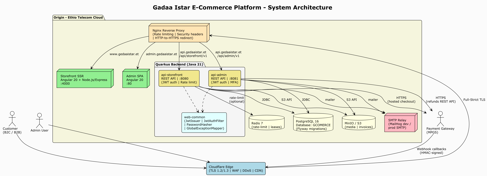
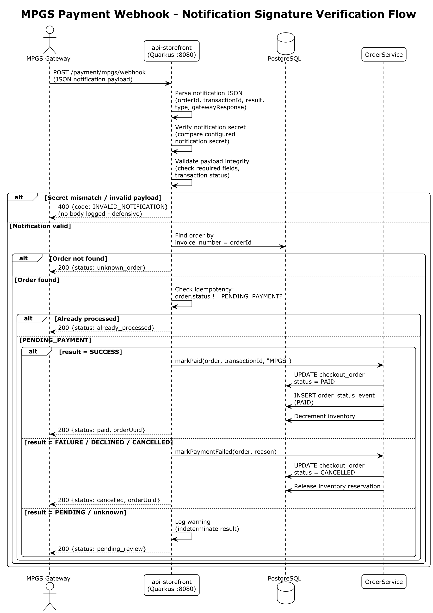

# Web Application Security Audit Documentation

**Prepared for:** Information Network Security Administration (INSA)
**Prepared by:** Gadaa Istar J&M Business Group plc
**Application:** Gadaa Istar Export E-Commerce Platform (gcomerce)
**Document version:** 1.0
**Date:** July 2026

---

## 1. Cover Page

| | |
|---|---|
| **Company name** | Gadaa Istar J&M Business Group plc |
| **Legal address** | Addis Ababa, Ethiopia |
| **Contact email** | hailubiniam73@gmail.com |
| **Application name** | Gadaa Istar Export E-Commerce Platform |
| **Internal code name** | gcomerce |
| **Production domains** | https://gedaaistar.et · https://admin.gedaaistar.et · https://api.gedaaistar.et |
| **Audit type** | Web Application Penetration Test & Security Assessment |
| **Submitted to** | Cyber Security Audit Division, INSA — Wollo Sefer, Addis Ababa |

---

## 2. Background of Organization

Gadaa Istar J&M Business Group plc is an Ethiopian export company specializing in the international trade of Ethiopian coffee (raw and processed) and specialty agricultural products, including white products and spicy products. The company serves both **B2B (wholesale)** and **B2C (retail)** international buyers.

To modernize and scale its export operations, Gadaa Istar has developed a custom hybrid **B2B + B2C e-commerce platform** that enables international buyers to browse the product catalog, request quotes (B2B), place orders, and pay securely through hosted payment gateways. The platform is integrated with **Mastercard Payment Gateway Services (MPGS)** for PCI-DSS-compliant payment processing.

The platform is hosted on **Ethio Telecom Cloud** with **Cloudflare** providing edge security, CDN, and TLS termination. The application is fully owned and operated by Gadaa Istar J&M Business Group plc

---

## 3. Introduction

This document provides the technical and security documentation required by INSA to conduct a comprehensive web application security audit of the Gadaa Istar Export E-Commerce Platform. It covers the business architecture, system features, audit scope, security functionality, secure coding practices, and contact information as specified in the INSA Web Application Testing Requirement document.

The platform consists of three primary surfaces that are in scope for this audit:

1. **Public storefront** (https://gadaaistar.et) — customer-facing product catalog, cart, checkout, account portal
2. **Admin back-office** (https://admin.gadaaistar.et) — internal management of products, orders, customers, payments, CMS
3. **REST APIs** (api.gadaaistar.et) — two Quarkus runtime modules serving the storefront and admin frontends

---

## 4. Objective of This Certificate Request

The objective of this request is to obtain a **web application security audit certificate** from INSA that:

- Validates the security posture of the Gadaa Istar e-commerce platform against national cyber security standards.
- Identifies vulnerabilities, misconfigurations, and risks that could be exploited by malicious actors.
- Provides actionable recommendations to remediate any findings.
- Demonstrates to our international buyers and payment partners that the platform meets Ethiopian national cyber security requirements.
- Supports compliance with **PCI DSS SAQ-A** (payment card data is never touched by our servers — all card data is entered on the MPGS hosted payment pages).

---

## 5. Business Architecture and Design

### 5.1 System Architecture Diagram



*Figure 1: Gadaa Istar E-Commerce Platform — System Architecture (PlantUML source: `diagrams/01-system-architecture.puml`)*

### 5.2 Data Flow Diagram

**Customer purchase flow (B2C):**


*Figure 2: Customer Purchase Flow (B2C) — Data Flow Diagram (PlantUML source: `diagrams/02-customer-purchase-flow.puml`)*

**B2B quote flow:**


*Figure 3: B2B Quote Request Flow — Data Flow Diagram (PlantUML source: `diagrams/03-b2b-quote-flow.puml`)*

**Admin login flow (with mandatory MFA):**


*Figure 4: Admin Login Flow — Two-Step Authentication with Mandatory TOTP MFA (Sequence Diagram) (PlantUML source: `diagrams/04-admin-login-mfa-sequence.puml`)*

---

## 6. Features of the Web Application

### 6.1 Development Frameworks

| Layer | Technology | Version |
|---|---|---|
| **Frontend — Storefront** | Angular (standalone components, signals, SSR) | 20.x |
| **Frontend — Admin** | Angular (standalone components, SPA) | 20.x |
| **Frontend SSR runtime** | Node.js + Express (via @angular/ssr) | 20 LTS |
| **Backend — Storefront API** | Quarkus (RESTEasy Reactive, Jackson) | 3.15.1 |
| **Backend — Admin API** | Quarkus (RESTEasy Reactive, Jackson) | 3.15.1 |
| **Backend language** | Java | 21 (Temurin) |
| **Build — Backend** | Gradle (multi-module) | 8.x |
| **Build — Frontend** | Angular CLI + npm | 20.x / 10+ |
| **Database** | PostgreSQL | 16 |
| **DB migrations** | Flyway | 10.17.0 |
| **ORM** | Hibernate ORM + Panache (via Quarkus) | managed by Quarkus BOM |
| **Object storage** | MinIO (dev) / S3-compatible (prod) | 8.5.11 (SDK) |
| **Cache / rate-limit** | Redis (optional, multi-instance) | 7-alpine |
| **Reverse proxy** | Nginx | latest stable |
| **Edge / CDN / WAF** | Cloudflare | — |
| **Containerization** | Docker + Docker Compose | — |
| **CI/CD** | GitHub Actions | — |

### 6.2 Libraries and Plugins

**Backend (key dependencies):**

| Library | Purpose | Version |
|---|---|---|
| `io.quarkus:quarkus-resteasy-reactive-jackson` | REST API (JAX-RS) + JSON serialization | 3.15.1 |
| `io.quarkus:quarkus-smallrye-openapi` | OpenAPI 3 spec generation + Swagger UI | 3.15.1 |
| `io.quarkus:quarkus-smallrye-health` | Health check endpoints (`/q/health`) | 3.15.1 |
| `io.quarkus:quarkus-micrometer-registry-prometheus` | Metrics export (`/q/metrics`) | 3.15.1 |
| `io.quarkus:quarkus-mailer` | Transactional email sending | 3.15.1 |
| `io.quarkus:quarkus-scheduler` | Cron jobs (abandoned-order sweeper, coupon reports) | 3.15.1 |
| `io.quarkus:quarkus-cache` | Application-level caching | 3.15.1 |
| `io.quarkus:quarkus-rest-client-reactive-jackson` | REST client (MPGS API calls) | 3.15.1 |
| `io.quarkus:quarkus-redis-client` | Redis-backed rate limiter + distributed lease | 3.15.1 |
| `io.quarkus:quarkus-hibernate-orm-panache` | JPA entities + repository pattern | 3.15.1 |
| `io.quarkus:quarkus-hibernate-validator` | Bean validation (JSR 380) | 3.15.1 |
| `io.quarkus:quarkus-flyway` | Database schema migrations | 3.15.1 |
| `org.postgresql:postgresql` | JDBC driver | 42.7.4 |
| `com.nimbusds:nimbus-jose-jwt` | JWT (HS256) issue + verify | managed by Quarkus BOM |
| `at.favre.lib:bcrypt` | Password hashing (BCrypt cost 12) | 0.10.2 |
| `commons-codec:commons-codec` | HMAC-SHA256 signature for payment gateway | 1.17.1 |
| `io.minio:minio` | S3-compatible object storage client (product media) | 8.5.11 |
| `net.coobird:thumbnailator` | Server-side image thumbnail generation | 0.4.20 |
| `org.projectlombok:lombok` | Boilerplate reduction | 1.18.34 |
| `org.mapstruct:mapstruct` | DTO ↔ entity mapping | 1.6.0 |

**Frontend (key dependencies):**

| Library | Purpose | Version |
|---|---|---|
| `@angular/*` (core, router, forms, common) | SPA framework | ^20.0.0 |
| `@angular/material` + `@angular/cdk` | UI component library | ^20.0.0 |
| `@angular/ssr` + `@angular/platform-server` | Server-side rendering (storefront) | ^20.0.0 |
| `angularx-qrcode` + `qrcode` | QR code generation (MFA enrollment) | ^19.0.0 / ^1.5.4 |
| `rxjs` | Reactive programming | ~7.8.1 |
| `express` | SSR Node.js server | ^4.21.1 |
| `eslint` + `@angular-eslint/*` | Linting (CI hard-fails on violations) | ^9.16.0 |
| `prettier` | Code formatting | ^3.3.3 |
| `karma` + `jasmine` | Unit testing | ~6.4.0 / ~5.4.0 |

### 6.3 Third-Party Integrations

| Integration | Purpose | Direction | Auth method |
|---|---|---|---|
| **MPGS (Mastercard Payment Gateway Services)** | Card payment (hosted checkout) | Browser → MPGS → Webhook | Merchant ID + API password + notification secret |
| **CyberSource Secure Acceptance** | Card payment (hosted checkout) | Browser → CyberSource → Webhook | Profile ID + access key + HMAC-SHA256 secret |
| **YagoutPay** | Domestic wallet/card payment (aggregator hosted checkout) | Browser → YagoutPay → encrypted return POST | Merchant ID + AES-256-CBC shared encryption key |
| **SMTP relay** | Transactional emails (verification, reset, shipment, B2B, coupon reports) | Server → SMTP | Username + password (prod); MailHog (dev) |
| **MinIO / S3** | Product media + invoice storage | Server → S3 API | Access key + secret key |
| **Cloudflare Turnstile / reCAPTCHA** | Contact form bot protection | Browser → Cloudflare | Site key + secret key |
| **Cloudflare Edge** | TLS, WAF, CDN, DDoS protection | All inbound traffic | Origin certificate (Full-Strict mode) |

### 6.4 Custom Development

The entire platform is custom-developed by the Gadaa Istar engineering team. Notable custom components include:

- **JWT issuer/verifier** (`JwtIssuer.java`) — HS256 token issue + verify with audience separation (storefront vs admin) and purpose-scoped short-lived tokens for MFA challenges.
- **TOTP MFA service** (`TotpService.java`) — self-contained RFC 6238 TOTP implementation (no third-party TOTP library) with base32 encoding and constant-time comparison.
- **Rate limiter** (`RateLimitService` + `@RateLimit` annotation) — pluggable backend (in-memory sliding window or Redis-backed Lua ZSET script) with per-endpoint bucket configuration.
- **Distributed lease** (`LeaseTokenService`) — SET NX PX + check-and-delete for the abandoned-order sweeper across replicas.
- **Payment gateway signature service** — HMAC-SHA256 signed field set builder + webhook signature verification.
- **Abandoned-order sweeper** — scheduled job that auto-cancels `PENDING_PAYMENT` orders past their TTL and releases inventory reservations.
- **Invoice numbering** — gap-free, per-fiscal-year invoice sequence using `SELECT ... FOR UPDATE` serialization.
- **Image thumbnail generation** — server-side 300px (card) and 800px (detail) variants on upload.

### 6.5 Actor / User Types

| Actor | Audience | Auth method | Description |
|---|---|---|---|
| **Anonymous visitor** | — | None | Browses public catalog, CMS pages; can add to guest cart |
| **B2C customer** | STOREFRONT | Email + password (BCrypt) → JWT | Retail buyer; places orders at retail price tier |
| **B2B customer** | STOREFRONT | Email + password (BCrypt) → JWT | Wholesale buyer; requests quotes, sees wholesale pricing, MOQ enforcement |
| **B2B admin viewer** | STOREFRONT | JWT (special email allowlist) | Internal account that can view ALL customer transactions |
| **Admin — SUPERADMIN** | ADMIN | Email + password + TOTP MFA → JWT | Full access to all admin modules and settings |
| **Admin — PRODUCT_MANAGER** | ADMIN | Email + password + TOTP MFA → JWT | Product, price, inventory, CMS content |
| **Admin — ORDER_MANAGER** | ADMIN | Email + password + TOTP MFA → JWT | Orders, shipments, refunds |
| **Admin — CUSTOMER_MANAGER** | ADMIN | Email + password + TOTP MFA → JWT | Customer accounts, B2B approvals, customer groups |
| **Admin — FINANCE** | ADMIN | Email + password + TOTP MFA → JWT | Orders (read), reports, refunds |
| **MPGS** | — | Notification secret webhook | Payment gateway server-to-server callback |

### 6.6 Dependencies and System Minimum Requirements

**Runtime dependencies:**

- JDK 21 (Temurin recommended) — for backend Quarkus runtimes
- Node.js 20 LTS + npm 10+ — for frontend SSR (storefront) and build
- PostgreSQL 16 — primary database
- Redis 7 (optional) — required only for multi-instance rate limiting / distributed lease
- MinIO or any S3-compatible storage — product media and invoice storage
- SMTP relay — transactional email delivery
- Nginx — reverse proxy / load balancer
- Docker Engine + Compose — containerized deployment

**Minimum production hardware (per node):**

- App tier (Quarkus): 2 vCPU, 4 GB RAM, 20 GB disk
- SSR tier (Node.js): 2 vCPU, 2 GB RAM, 10 GB disk
- Database tier (PostgreSQL): 4 vCPU, 8 GB RAM, 100 GB SSD
- Redis (if used): 1 vCPU, 1 GB RAM

**External service dependencies:**

- MPGS merchant account (merchant ID, API password, notification secret)
- Cloudflare account (zone, origin certificate, WAF rules)
- Ethio Telecom Cloud hosting account

### 6.7 Implemented Security Standards

| Standard / Practice | Implementation |
|---|---|
| **PCI DSS SAQ-A** | Card data never touches our servers — all card/wallet entry happens on the gateways' hosted pages (MPGS, CyberSource, YagoutPay). We only receive signed/encrypted callbacks with transaction IDs (no PAN, no CVV). |
| **OWASP Top 10 mitigation** | Input validation (Bean Validation), JWT auth, RBAC, parameterized queries (JPA/Hibernate), CSRF-safe (Bearer token, no cookies for auth), security headers (HSTS, X-Frame-Options, X-Content-Type-Options, Referrer-Policy, Permissions-Policy). |
| **Ethiopian VAT compliance (ERCA)** | Tax classes (STANDARD 15%, EXPORT zero-rated, EXEMPT), per-fiscal-year invoice sequences, credit note support. |
| **RFC 6238 TOTP** | Mandatory MFA for all admin accounts (Google Authenticator / Authy / 1Password compatible). |
| **RFC 4648 Base32** | TOTP secret encoding. |
| **JWT (RFC 7519)** | HS256-signed access tokens (15-min TTL) + rotating refresh tokens (30-day TTL, hashed at rest). |
| **HMAC-SHA256** | Payment gateway webhook signature verification. |
| **BCrypt (cost 12)** | Password hashing for all customer and admin accounts. |

### 6.8 Devices That May Impact Penetration Test Results

The following devices / services are in place between the tester and the application and may affect test results:

| Device / Service | Location | Impact on testing |
|---|---|---|
| **Cloudflare WAF** | Edge (in front of all traffic) | May block or challenge SQL injection, XSS, and abnormal payloads. Managed rules + custom rules. Rate limiting at edge. For unfiltered testing, INSA's IP can be allowlisted on request. |
| **Cloudflare DDoS protection** | Edge | May rate-limit or challenge high-volume requests. |
| **Cloudflare TLS (Full-Strict)** | Edge | TLS 1.2 / 1.3 only; origin cert required. |
| **Nginx reverse proxy** | Origin | Rate limiting (`limit_req_zone`): 20 r/s general API, 5 r/s auth endpoints. HTTP→HTTPS redirect. Security headers injected. |
| **Application-level rate limiter** | Quarkus (api-storefront) | Per-endpoint sliding window (e.g., login: 10/min, register: 5/10min, forgot-password: 3/10min). Configurable via `gadaa.ratelimit.*`. Can be disabled for testing via `GADAA_RATELIMIT_ENABLED=false`. |
| **Redis-backed rate limiter** | Quarkus (if enabled) | Multi-instance sliding window via Lua ZSET. Fail-open on Redis errors. |

> **Note for testers:** To bypass Cloudflare WAF and Nginx rate limiting for thorough testing, INSA may provide source IPs for allowlisting. Application-level rate limiting can be disabled in a staging environment. Please coordinate with our technical contact (see Section 11).

---

## 7. Audit Scope Definition

### 7.1 Scope Definition Table (Mandatory)

| # | Name of Asset to be Audited | URL / IP | Type | Test Account (as required by tester) |
|---|---|---|---|---|
| 1 | Gadaa Istar Storefront (public) | `https://gadaaistar.et` | **Public web portal/site** | None required (public catalog browsing). Test B2C account will be provided. |
| 2 | Gadaa Istar Storefront API | `https://api.gadaaistar.et/api/storefront/v1` | **Public API** | B2C + B2B customer test accounts will be provided. |
| 3 | Gadaa Istar Admin Back-Office | `https://admin.gadaaistar.et` | **Internal web portal** | Admin test accounts (one per role: SUPERADMIN, PRODUCT_MANAGER, ORDER_MANAGER, CUSTOMER_MANAGER, FINANCE) will be provided. |
| 4 | Gadaa Istar Admin API | `https://api.gadaaistar.et/api/admin/v1` | **Internal API** | Admin test accounts (one per role) will be provided. |
| 5 | MPGS Webhook Endpoint | `https://api.gadaaistar.et/api/storefront/v1/payment/mpgs/webhook` | **Public API (webhook)** | No account; notification secret verification. Test payload + secret can be provided. |
| 6 | YagoutPay Return Endpoints | `https://api.gadaaistar.et/api/storefront/v1/payment/yagoutpay/return` + `.../failure` | **Public API (gateway return)** | No account; AES-256-CBC encrypted fields + strict order/amount/currency validation. Enabled only when gateway credentials are configured. |
| 7 | Storefront SSR (origin) | `10.0.1.20:4000` / `10.0.1.21:4000` (internal) | **Internal local application** | — |
| 8 | Admin SPA (origin) | `10.0.1.30:80` (internal) | **Internal local application** | — |
| 9 | api-storefront (origin) | `10.0.1.10:8080` / `10.0.1.11:8080` (internal) | **Internal local application** | — |
| 10 | api-admin (origin) | `10.0.1.10:8081` / `10.0.1.11:8081` (internal) | **Internal local application** | — |
| 11 | PostgreSQL database | `10.0.1.x:5432` (internal, DB: `GCOMERCE`) | **Internal infrastructure** | Read-only DB account can be provided for schema review. |
| 12 | MinIO / S3 object storage | `10.0.1.x:9000` (internal) | **Internal infrastructure** | — |
| 13 | Redis (if deployed) | `10.0.1.x:6379` (internal) | **Internal infrastructure** | — |

### 7.2 Out of Scope

- The hosted payment pages themselves (MPGS, CyberSource, YagoutPay — PCI-DSS-certified third-party services; we never receive card data).
- Cloudflare's internal infrastructure (edge network, WAF engine internals).
- Ethio Telecom Cloud's underlying hypervisor / physical infrastructure.
- Third-party SMTP relay infrastructure (in production).
- End-user devices (customer browsers, admin workstations).

### 7.3 Test Accounts

The following test accounts will be provisioned for INSA's testing team upon request. Credentials will be communicated securely (out-of-band) and rotated after the audit:

| Account type | Email / username | Role | Notes |
|---|---|---|---|
| B2C customer | `insa-test-b2c@gedaaistar.et` | Customer (B2C) | Active, email-verified |
| B2B customer | `insa-test-b2b@gedaaistar.et` | Customer (B2B) | Active, approved, wholesale pricing tier |
| Admin — Super | `insa-superadmin@gedaaistar.et` | SUPERADMIN | MFA enrolled; TOTP secret shared securely |
| Admin — Product | `insa-product@gedaaistar.et` | PRODUCT_MANAGER | MFA enrolled |
| Admin — Orders | `insa-orders@gedaaistar.et` | ORDER_MANAGER | MFA enrolled |
| Admin — Customers | `insa-customer-mgr@gedaaistar.et` | CUSTOMER_MANAGER | MFA enrolled |
| Admin — Finance | `insa-finance@gedaaistar.et` | FINANCE | MFA enrolled |

---

## 8. Security Functionality Document

### 8.1 User Roles and Access Control

**Implementation:** Role-based access control (RBAC) is enforced at two layers:

1. **Database layer** — `role` and `permission` tables with `role_permission` join table (Flyway V1). Five seeded admin roles: `SUPERADMIN`, `PRODUCT_MANAGER`, `ORDER_MANAGER`, `CUSTOMER_MANAGER`, `FINANCE`.

2. **Application layer** — `SecurityContextHolder` (per-request, CDI `@RequestScoped`) populated by `JwtAuthFilter` from the JWT `roles` claim. Endpoints call `requireCustomer()`, `requireAdmin()`, or `requireAnyRole(String...)` to enforce access. `requireAnyRole` throws `ForbiddenException` (403) if the caller lacks any of the allowed roles.

3. **Frontend layer** — Angular route guards (`authGuard`, `guestGuard`, `roleGuard`, `mfaChallengeGuard`) prevent unauthorized navigation. `roleGuard` reads `data: { roles: [...] }` from the route definition.

**Sample — admin endpoint with role enforcement:**

```java
@POST
@Path("/products")
public ProductDto create(@Valid ProductDtos.CreateRequest req) {
    securityContext.requireAdmin();
    securityContext.requireAnyRole("SUPERADMIN", "PRODUCT_MANAGER");
    return productsService.create(req);
}
```

### 8.2 Authorization Mechanisms

**Implementation:**

- **JWT-based authorization** — Every authenticated request carries `Authorization: Bearer <token>`. The `JwtAuthFilter` validates the token (signature, issuer, audience, expiration) and populates `SecurityContextHolder`.
- **Audience separation** — Storefront tokens (`aud_type=STOREFRONT`) cannot access admin endpoints and vice versa. Path-based routing: `/api/admin/*` validates against the admin secret; everything else uses the storefront secret.
- **Purpose-scoped tokens** — Short-lived JWTs with a `purpose` claim in the JOSE `typ` header (e.g., `mfa-challenge`) prevent token reuse across flows. `verifyPurpose()` rejects tokens with the wrong purpose.
- **Frontend interceptor** — `authInterceptor` attaches the Bearer token to every API call and performs a single silent refresh on 401 before failing.

### 8.3 Input Validation and Sanitization

**Implementation:**

- **Bean Validation (JSR 380 / Jakarta Validation)** — All request DTOs use `@Valid` + constraint annotations (`@NotBlank`, `@Email`, `@Size`, `@Pattern`, `@Min`, `@Max`, custom validators). Quarkus Hibernate Validator enforces these at the JAX-RS layer before the request reaches the service.
- **Global exception mapper** — `GlobalExceptionMapper` catches `ConstraintViolationException` and returns a structured 400 response with per-field error details. It never leaks stack traces or internal messages on 5xx errors.
- **SQL injection prevention** — All database access uses JPA/Hibernate with parameterized queries (Panache repository methods). No raw SQL string concatenation in application code. Flyway migrations use parameterized DDL.
- **XSS prevention** — Angular's default template binding (`{{ }}`) contextually escapes output. `innerHTML` is avoided; where used, content is sanitized via Angular's `DomSanitizer`. Backend never returns HTML in API responses (JSON only).
- **Email normalization** — All email inputs are trimmed and lowercased before DB lookup/insert to prevent case-sensitivity bypass.

**Sample — validated DTO:**

```java
public record RegisterRequest(
    @NotBlank @Size(max = 255) @Email String email,
    @NotBlank @Size(min = 8, max = 128) String password,
    @NotBlank @Size(max = 120) String firstName,
    @NotBlank @Size(max = 120) String lastName,
    @Pattern(regexp = "B2C|B2B") String customerType,
    String companyName, String companyTin, String companyVatNumber,
    @Size(max = 64) String phone,
    String preferredCurrency, String preferredLocale, String customerGroupCode
) {}
```

### 8.4 Session Management

**Implementation:**

- **Access tokens** — JWT HS256, 15-minute TTL (`gadaa.jwt.access-ttl-minutes`). Claims: `sub` (user ID), `iss` (audience-specific issuer), `aud` (audience), `exp`, `iat`, `jti` (UUID), `email`, `roles`, `aud_type`.
- **Refresh tokens** — Rotating, 30-day TTL (`gadaa.jwt.refresh-ttl-days`). Stored as SHA-256 hashes in `customer_refresh_token` / `admin_refresh_token` tables (never stored in plaintext). Each rotation invalidates the previous token and links via `replaced_by_id` for audit. IP address and User-Agent are recorded.
- **Logout** — Revokes the presented refresh token (sets `revoked_at`). On password change / reset, all existing refresh tokens for the user are revoked.
- **Token secret management** — JWT secrets (`GADAA_JWT_STOREFRONT_SECRET`, `GADAA_JWT_ADMIN_SECRET`) are loaded from environment variables in dev and from **HashiCorp Vault** in staging/production. Minimum 32 characters (validated on startup).
- **No server-side session state** — The platform is stateless; all session state lives in the JWT. This simplifies horizontal scaling.
- **Idempotency** — Order creation supports an `Idempotency-Key` header to prevent duplicate orders from network retries.

### 8.5 Error Handling and Logging

**Implementation:**

- **Global exception mapper** (`GlobalExceptionMapper`) — Single `@Provider` that maps every uncaught exception to a standard error envelope (`ErrorResponse` with `code`, `message`, `details`, `correlationId`, `timestamp`). Priorities:
  1. `ApiException` (domain exceptions) — respected as-is (status + code from exception).
  2. `ConstraintViolationException` — 400 with field-error map.
  3. JAX-RS `NotFoundException` — 404 `ROUTE_NOT_FOUND`.
  4. `WebApplicationException` — pass-through with generic envelope.
  5. Anything else — 500 `INTERNAL_ERROR`, logged with stack trace, generic message to client (no internal leakage).
- **Correlation IDs** — `CorrelationIdFilter` attaches a UUID to every request (from `X-Correlation-Id` header or generated). Written to SLF4J MDC, stored on request context, echoed back in response header. Enables end-to-end log tracing.
- **Structured logging** — Production profile uses JSON console logging (`%prod.quarkus.log.console.json=true`) for log aggregation. SQL logging is disabled in production.
- **Rate limit errors** — Return HTTP 429 with a `Retry-After` header so well-behaved clients back off.
- **No sensitive data in logs** — Passwords, tokens, and card data are never logged. The payment webhook handler deliberately does not log failed signature bodies (defense against attackers spraying malformed POSTs).

### 8.6 Secure Communications

**Implementation:**

| Channel | Protection |
|---|---|
| Browser ↔ Cloudflare edge | TLS 1.2 / 1.3 (Cloudflare-managed cert), HSTS (`max-age=63072000; includeSubDomains; preload`) |
| Cloudflare edge ↔ Origin (Nginx) | TLS Full-Strict (Cloudflare origin certificate at `/etc/ssl/cloudflare/`) |
| Nginx ↔ Quarkus / Node.js | Internal network (Docker network / private subnet). HTTP internally; TLS terminates at edge. |
| Backend ↔ PostgreSQL | JDBC over internal network; TLS can be enabled via `quarkus.datasource.jdbc.ssl-mode=require` in prod. |
| Backend ↔ Redis | `redis://` (unencrypted internal); can be upgraded to `rediss://` for TLS. |
| Backend ↔ MPGS | HTTPS (`https://test-gateway.mastercard.com` / production gateway) |
| Backend ↔ SMTP | STARTTLS configurable (`quarkus.mailer.start-tls`); disabled in dev (MailHog), enabled in prod. |
| Backend ↔ S3 / MinIO | HTTPS in prod (S3 endpoint); HTTP in dev (local MinIO). |

**Security headers (injected by Nginx):**

```
Strict-Transport-Security: max-age=63072000; includeSubDomains; preload
X-Frame-Options: DENY
X-Content-Type-Options: nosniff
Referrer-Policy: strict-origin-when-cross-origin
Permissions-Policy: geolocation=(), microphone=(), camera()
X-Robots-Tag: noindex, nofollow   (admin only)
```

**Payment webhook verification flow (MPGS):**



*Figure 5: MPGS Payment Webhook — Notification Signature Verification Flow (PlantUML source: `diagrams/06-payment-webhook-flow.puml`)*

---

## 9. Secure Coding Standard Document

### 9.0 Security Architecture — Defense in Depth


*Figure 6: Security Architecture — Defense in Depth across 4 Layers (PlantUML source: `diagrams/05-security-architecture.puml`)*

The Gadaa Istar engineering team follows the secure coding practices listed below. These are enforced through code review, CI linting (ESLint for frontend, Gradle build checks for backend), and the patterns established in the shared `web-common` module.

### 9.1 OWASP Secure Coding Practices — Adoption Summary

| OWASP Practice | Our Implementation |
|---|---|
| **Secure Input Handling** | Bean Validation on all DTOs; email normalization; input length limits; `@Pattern` for enums; Angular template auto-escaping; `DomSanitizer` for any dynamic HTML. |
| **Secure File Handling** | Max upload size enforced (`S3_MAX_UPLOAD_BYTES=20MB` default, `quarkus.http.limits.max-body-size=25M`); RESTEasy Reactive streams multipart to disk (not in-memory) to prevent OOM; server-side image resizing via Thumbnailator; files stored in MinIO/S3 (never on the app server filesystem); MIME type validation on upload. |
| **Authentication and Session Management** | BCrypt cost-12 password hashing; JWT HS256 with 15-min access TTL; rotating refresh tokens (hashed at rest, 30-day TTL); mandatory TOTP MFA for admins; email verification + password reset flows with time-limited tokens; session revocation on password change. |
| **Software Patching and Updates** | Dependabot / dependency scanning via GitHub; Quarkus platform BOM pins all transitive versions; Gradle `./gradlew dependencyCheck` available; CI runs on every push and PR. |
| **Review Third-Party Components** | All dependencies pinned to specific versions in `gradle.properties` and `package.json` (no floating `latest`); new dependencies require code review; SBOM available via Gradle `dependencies` task and `npm ls`. |
| **Secure Communication** | TLS 1.2/1.3 everywhere (edge + origin); HSTS; HTTPS-only for all external API calls (MPGS, SMTP STARTTLS in prod); no plaintext secrets over public networks. |
| **Error Handling** | Global exception mapper; no stack traces or internal messages to clients on 5xx; structured error envelopes with correlation IDs; no sensitive data in logs. |
| **Access Control** | RBAC at DB + app + frontend layers; audience-separated JWTs; `requireAnyRole()` on every sensitive endpoint; Angular route guards. |
| **Cryptographic Practices** | BCrypt (passwords), HMAC-SHA256 (JWT signing + payment gateway signatures), SHA-256 (refresh token hashing at rest); `SecureRandom` for TOTP secret generation; no custom crypto. |

### 9.2 Additional Secure Coding Rules

1. **Never log secrets** — Passwords, JWT tokens, refresh tokens, payment gateway keys, and card data are never written to logs. The `CorrelationIdFilter` ensures traceability without exposing payloads.
2. **Never trust user input** — All external input passes through Bean Validation before reaching service logic. Email is normalized; IDs are typed (`Long`); enums are validated via `@Pattern`.
3. **Use parameterized queries only** — JPA/Hibernate + Panache repositories. No string-concatenated SQL anywhere. Code review rejects any raw SQL.
4. **Fail secure on auth** — Invalid JWTs are treated as anonymous (not rejected outright) so public endpoints work; endpoint-level `requireCustomer()` / `requireAdmin()` enforce auth where needed. Invalid passwords return the same error as unknown emails (`INVALID_CREDENTIALS`) to prevent user enumeration.
5. **Idempotency for mutations** — Order creation and payment webhooks support idempotency keys / state checks to prevent duplicate processing.
6. **Constant-time comparisons** — TOTP verification uses constant-time comparison across the tolerance window to prevent timing attacks.
7. **No cookies for auth** — Authentication uses `Authorization: Bearer` headers, not cookies, eliminating CSRF risk for auth. `SameSite` cookie attributes are not needed because no auth cookies are set.
8. **CORS is explicit** — Only the configured storefront and admin origins are allowed (`quarkus.http.cors.origins`). Dev profile allows `/.*/` for local development only.
9. **Secrets in Vault (prod)** — All secrets (JWT keys, MPGS keys, SMTP credentials, DB passwords) come from environment variables in dev and HashiCorp Vault in staging/production. No secrets in source code or config files.
10. **Defense in depth** — WAF (Cloudflare) → Nginx rate limiting → Application rate limiting → JWT auth → RBAC → Input validation → Parameterized queries. Multiple layers must fail for an attack to succeed.

---

## 10. Previous Security Test Report

This is the **first formal security audit** of the Gadaa Istar Export E-Commerce Platform. No previous penetration test or security audit report exists.

Internal quality gates that have been performed:

- **CI pipeline (GitHub Actions)** — Backend build + unit/integration tests (JUnit 5 + RestAssured + Testcontainers PostgreSQL) on every push/PR. Frontend lint (ESLint) + build on every push/PR.
- **Flyway migration validation** — CI validates that all migrations apply cleanly on an empty PostgreSQL 16 database.
- **ESLint** — Frontend code must pass ESLint with zero errors (CI hard-fails on violations).

---

## 11. Contact Information and Communication Channel

| Name | Role | Address (Email and Mobile) |
|---|---|---|
| **[Primary technical contact name]** | Technical Lead, Gadaa Istar e-commerce platform | Email: [tech-contact@gedaaistar.et] · Mobile: [+251-xxx-xxx-xxxx] |
| **[Secondary technical contact name]** | DevOps / Infrastructure | Email: [devops@gedaaistar.et] · Mobile: [+251-xxx-xxx-xxxx] |
| **Gadaa Istar J&M Business Group plc** | Company | Email: info@gedaaistar.et · Address: Addis Ababa, Ethiopia |

> **Note:** Specific names and phone numbers for the primary and secondary technical contacts will be filled in before submission. These are the personnel who can provide test accounts, allowlist INSA IPs on Cloudflare/WAF, disable rate limiting in staging, and answer technical questions during the audit.

---

## 12. Glossary of Abbreviations

| Abbreviation | Full Form |
|---|---|
| API | Application Programming Interface |
| BOM | Bill of Materials |
| CDI | Contexts and Dependency Injection |
| CDN | Content Delivery Network |
| CI | Continuous Integration |
| CMS | Content Management System |
| CORS | Cross-Origin Resource Sharing |
| CSRF | Cross-Site Request Forgery |
| CVV | Card Verification Value |
| DB | Database |
| DDL | Data Definition Language |
| DTO | Data Transfer Object |
| DSS | Data Security Standard (as in PCI DSS) |
| ERCA | Ethiopian Revenue and Customs Authority |
| HMAC | Hash-based Message Authentication Code |
| HS256 | HMAC with SHA-256 (JWT signing algorithm) |
| HSTS | HTTP Strict Transport Security |
| HTML | HyperText Markup Language |
| HTTP | HyperText Transfer Protocol |
| HTTPS | HTTP Secure (HTTP over TLS) |
| ID | Identifier |
| INSA | Information Network Security Administration |
| IP | Internet Protocol |
| JDBC | Java Database Connectivity |
| JDK | Java Development Kit |
| JOSE | JSON Object Signing and Encryption |
| JPA | Java Persistence API |
| JSON | JavaScript Object Notation |
| JSR | Java Specification Request |
| JWT | JSON Web Token |
| LTS | Long-Term Support |
| MDC | Mapped Diagnostic Context |
| MFA | Multi-Factor Authentication |
| MIME | Multipurpose Internet Mail Extensions |
| MOQ | Minimum Order Quantity |
| MPGS | Mastercard Payment Gateway Services |
| ORM | Object-Relational Mapping |
| OWASP | Open Web Application Security Project |
| PAN | Primary Account Number (credit card number) |
| PCI | Payment Card Industry |
| PR | Pull Request |
| QR | Quick Response (code) |
| RBAC | Role-Based Access Control |
| REST | Representational State Transfer |
| RFC | Request for Comments |
| SAQ | Self-Assessment Questionnaire (as in PCI DSS SAQ-A) |
| SBOM | Software Bill of Materials |
| SDK | Software Development Kit |
| SHA | Secure Hash Algorithm |
| SMTP | Simple Mail Transfer Protocol |
| SPA | Single Page Application |
| SQL | Structured Query Language |
| SSD | Solid State Drive |
| SSR | Server-Side Rendering |
| TLS | Transport Layer Security |
| TOTP | Time-Based One-Time Password |
| TTL | Time To Live |
| UI | User Interface |
| URL | Uniform Resource Locator |
| UUID | Universally Unique Identifier |
| VAT | Value Added Tax |
| WAF | Web Application Firewall |
| XSS | Cross-Site Scripting |

---

## 13. Conclusion

The Gadaa Istar Export E-Commerce Platform is a custom-built, production-grade B2B + B2C e-commerce platform designed with security as a foundational principle. The platform follows OWASP secure coding practices, implements PCI DSS SAQ-A-compliant payment processing (card data never touches our servers), enforces mandatory MFA for all administrative accounts, and uses defense-in-depth across the network, application, and data layers.

We request INSA to conduct a comprehensive web application penetration test and security assessment of the platform as described in the scope table (Section 7). We are committed to promptly remediating any vulnerabilities identified during the audit and to maintaining a strong cyber security posture in line with Ethiopian national standards.

All necessary test accounts, credentials, and network access (IP allowlisting) will be provided to INSA's testing team upon request. We look forward to receiving the audit report and the security certificate.

---

**Gadaa Istar J&M Business Group plc**
Addis Ababa, Ethiopia
July 2026
